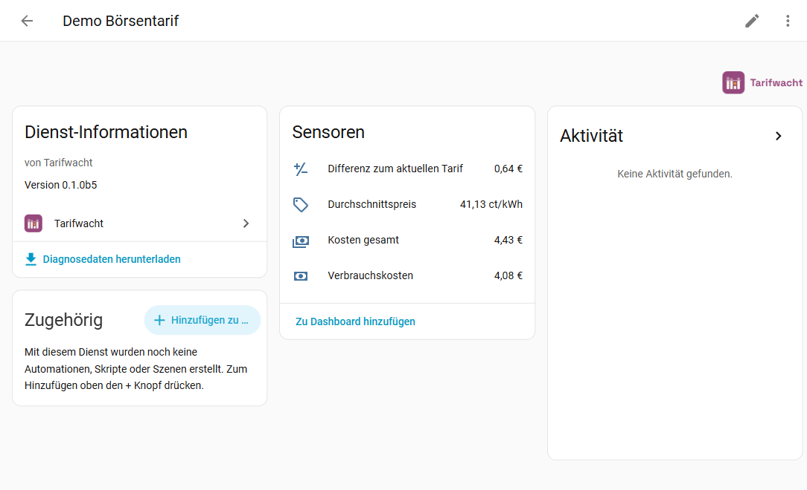
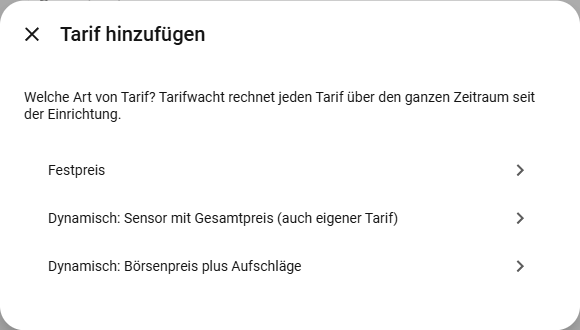
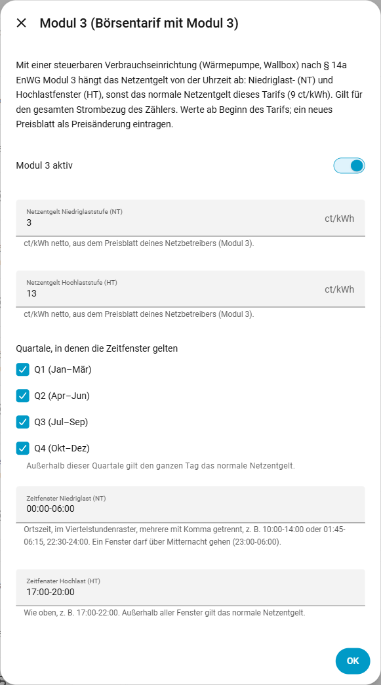
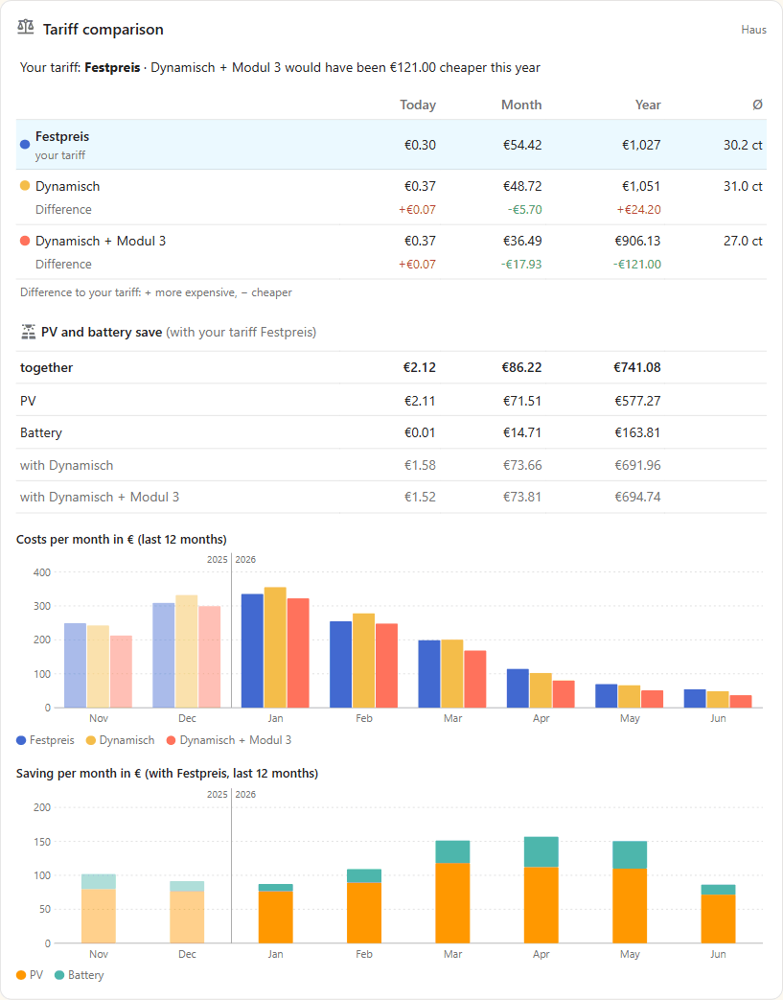
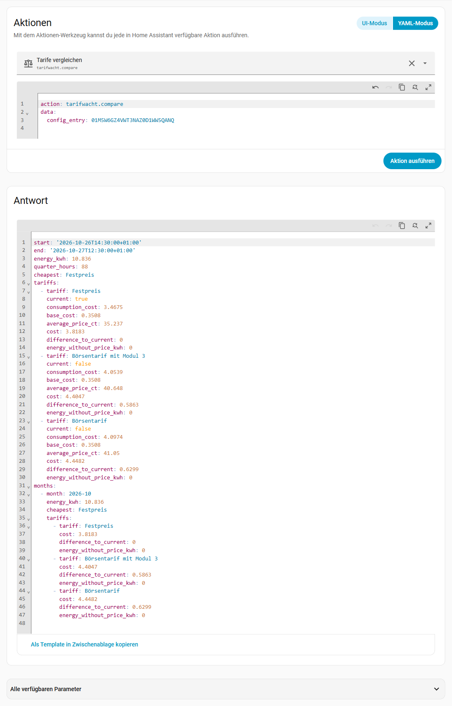

<picture>
  <source media="(prefers-color-scheme: dark)" srcset="https://raw.githubusercontent.com/tarifwacht/integration/main/assets/github/readme-header-dark@2x.png">
  
</picture>

[](https://hacs.xyz/)
[](https://github.com/tarifwacht/integration/releases)
[](https://github.com/tarifwacht/integration/actions/workflows/ci.yml)
[](LICENSE)
[](https://tarifwacht.github.io/integration/?lang=en)

🇩🇪 [Deutsch](https://github.com/tarifwacht/integration/blob/main/README.md) · 🇬🇧 **English**

**What would your electricity have cost with a different tariff?** Tarifwacht ("tariff watch") prices your actual grid consumption in Home Assistant quarter hour by quarter hour against any number of tariffs – fixed price, dynamic, with or without Modul 3 – and shows which one would have been cheaper. Each dynamic tariff gets the price of **exactly that quarter hour**, not the price of whatever moment the meter happens to report.

**Try it without installing:** the [demo](https://tarifwacht.github.io/integration/?lang=en) shows the card, the dashboard, devices, monthly summary and year in review for a flat and a house with PV, battery, an EV and a heat pump, there also the saving by PV and battery – with made-up prices and tariffs, but computed by the integration's own code.

Tarifwacht is built for Germany: quarter-hour day-ahead prices, German price components and the time-variable grid fee under § 14a EnWG. Days and months (base prices) follow German local time.

> **No billing or tariff advice.** The figures are a guide. Your supplier's bill is what counts.

The user interface is available in German and English and follows the language of your Home Assistant.



## Contents

- [Features](#features) · [Notes on the comparison](#notes-on-the-comparison) · [What Tarifwacht does not do](#what-tarifwacht-does-not-do)
- **Getting started:** [Requirements](#requirements) · [Installation](#installation) · [Setup](#setup) · [More tariffs](#more-tariffs) · [Adding a dynamic tariff](#adding-a-dynamic-tariff) · [Price components](#price-components-what-goes-where) · [Where do I see my tariffs?](#where-do-i-see-my-tariffs) · [Changing a tariff](#changing-a-tariff) · [Modul 3](#modul-3--14a-enwg) · [PV and battery](#pv-and-battery)
- **Using it:** [Entities](#entities) · [Card](#card) · [Dashboard](#dashboard-tariff-comparison) · [Comparison for a period](#comparison-for-a-period) · [Looking back before the setup](#looking-back-before-the-setup) · [Import statistics](#import-statistics) · [Recalculate statistics](#recalculate-statistics)
- **More:** [Privacy](#privacy) · [Troubleshooting](#troubleshooting) · [Removal](#removal) · [Reporting issues](#reporting-issues) · [Thanks](#thanks) · [Sister integrations](#sister-integrations)

## Features

- **Cost per tariff** (€): consumption cost and total cost (including base price) – with long-term statistics for statistics cards and the energy dashboard.
- **Difference to current tariff** (€) for every other tariff. Positive means this tariff would have been more expensive; negative, cheaper.
- **Average price** per tariff (ct/kWh, including base price) and the **cheapest tariff** so far.
- **Any number of tariffs:** fixed price, dynamic with a total-price sensor, or dynamic from exchange price plus grid fee, taxes/levies, supplier surcharge and VAT.
- **Modul 3** (§ 14a EnWG): time-variable grid fee with low-load and high-load windows per quarter.
- **Saving by PV and battery** per tariff (€): what the PV system and battery saved against buying all consumption, with feed-in tariff and § 51 EEG – hybrid inverters and batteries with their own inverter, see [PV and battery](#pv-and-battery). With the purchase costs also when PV and battery have paid for themselves, or are expected to.
- **A card of its own for the dashboard:** your tariff, whether another one would have been cheaper and what PV and battery save – today, this month and this year, plus bars per month. No extra cards from HACS, see [Card](#card).
- **Price changes from a date**, e.g. new grid fees on 1 January – the old prices still apply before that date.
- **One-off bonus** per tariff and per price change (a new contract), e.g. a 250 € switching bonus – lowers the total cost once, on the day it is credited.
- **Base prices** optional, per month or per year, booked pro rata per day.
- **Comparison for any period** via an action, broken down by month – also **before the setup**, as far back as your meter's long-term statistics go: what would last year have cost with each tariff? On request also [written into the long-term statistics](#import-statistics).
- **Prices every tariff from the setup on:** consumption and prices are stored per quarter hour. A tariff added or corrected later therefore applies to the whole period.
- **Loses nothing:** if the meter drops out or Home Assistant restarts, the consumption of the gap is booked afterwards. If a price is missing, Tarifwacht never uses 0 €. Meter resets and implausible jumps are detected and not booked.
- **Easy on SD cards:** writes only once per quarter hour (closed days once a day into a yearly archive) and updates the sensors at most once a minute.
- Local only: reads existing entities, no cloud. Only for looking back does Tarifwacht load public exchange prices from SMARD.de.

## Notes on the comparison

- The comparison assumes the **same consumption behaviour**. With a dynamic tariff many people shift consumption into cheap hours – the comparison cannot reflect that. It rather shows what a dynamic tariff brings *at least*.
- Enter **all price components on both sides** in the same way, otherwise the comparison is skewed. The total price of a dynamic tariff is the exchange price plus grid fee, concession fee, levies, electricity tax and supplier surcharge, plus VAT. The figures are in the price sheets of your supplier and grid operator; what goes where is under [Price components](#price-components-what-goes-where).
- Home Assistant usually measures with its own meter (optical reader, energy meter), your supplier with the grid operator's meter. Small differences are normal.

## Requirements

- Home Assistant 2026.3 or newer.
- A **grid import meter**: a cumulative energy sensor (Wh, kWh or MWh) for the energy drawn from the grid, ideally the meter at the grid connection point.
- For dynamic tariffs a **price sensor** in €/kWh, ideally with a forecast per quarter hour or hour:

| Source (integration) | Total price | Exchange price | Status |
|---|---|---|---|
| [EPEX Spot](https://github.com/mampfes/ha_epex_spot) | `…_total_price` | `…_market_price` | tested |
| [Nord Pool](https://github.com/custom-components/nordpool) (HACS) | sensor with VAT and additional costs | sensor without VAT and additional costs | experimental |
| [ENTSO-E](https://github.com/JaccoR/hass-entso-e) (HACS) | average price sensor with surcharges | average price sensor without surcharges | experimental |

"Experimental" means: the format was reproduced from the integration's source code and real market data, but has not yet been checked on a running installation. If you use one of them, I'd appreciate feedback with the diagnostics file. Home Assistant's own Nord Pool integration does not provide a forecast attribute and is not supported.

A sensor without a forecast works too: its current value applies until it changes. If Home Assistant is not running for a while, though, the prices for that time are missing – with a forecast Tarifwacht catches up on them.

## Installation

**One click:** [](https://my.home-assistant.io/redirect/hacs_repository/?owner=tarifwacht&repository=integration&category=integration) → install, restart Home Assistant → [](https://my.home-assistant.io/redirect/config_flow_start/?domain=tarifwacht)

Or by hand:

1. *Settings → Marketplace → Browse*, search for Tarifwacht and install it (before Home Assistant 2026.11: search for it in HACS and download it). Restart Home Assistant.
2. *Settings → Devices & services → Add integration → Tarifwacht*.

Note: the old HACS dashboard (before Home Assistant 2026.11) does not show the icon ([HACS issue #5171](https://github.com/hacs/integration/issues/5171)); the Marketplace and the settings do.

## Setup

1. **Grid import meter:** name (e.g. "Home") and meter.
2. **Fixed-price tariff:** energy price (ct/kWh, gross), optionally the base price per month. It becomes "My current tariff".
3. **Dynamic tariff:** first choose the kind – **exchange price plus surcharges** (recommended, see [Adding a dynamic tariff](#adding-a-dynamic-tariff)) or a sensor with the total price (also your own tariff; calculates only from the setup on) –, then the prices.

This creates the first two tariffs. If you set up Tarifwacht before 0.1.0 with a total price sensor: add the dynamic tariff a second time as "exchange price plus surcharges", then you can delete the old one.

### More tariffs

*Tarifwacht → Add tariff* and choose the kind:



| Kind | Inputs |
|---|---|
| Fixed price | energy price (ct/kWh, gross) |
| Dynamic: sensor with the total price (also your own tariff) | any sensor in €/kWh that already contains the whole price: the total price of a dynamic tariff, or your own tariff as a template sensor (e.g. a tariff with day and night prices). A sensor only knows its own past – calculates only from the setup on |
| Dynamic: exchange price plus surcharges | exchange price sensor; grid fee, taxes/levies, supplier surcharge (each ct/kWh net); VAT (%) |

Every tariff has an optional base price and the switch **My current tariff** – the other tariffs show their difference to this one. What rarely changes sits collapsed under **More (optional)**: whether the base price is per month (default) or per year and, for the exchange price tariff, the VAT (default 19 %).

Under **Bonus (optional)** (collapsed) goes a **one-off bonus**, such as a new-customer or switching bonus: **One-off bonus** (€, gross) and **Bonus credited on**. Example: a 250 € switching bonus credited on 1 February → total cost, difference, cheapest tariff and the statistics of this tariff drop once by 250 € on 1 February at 0:00 (German local time); the consumption cost stays. If the bonus comes only after the first contract year, enter the end of that year as the date. A date in the future counts once it is reached. If it lies before the setup, the bonus counts only in the [comparison for a period](#comparison-for-a-period) and when [importing statistics](#import-statistics), if the period contains the date and the meter's statistics reach back that far. **If you switch regularly**, your electricity stays one tariff: the new contract goes in as a [price change from a date](#changing-a-tariff) with its own bonus (section **Bonus (optional)** in the same form). Then “My current tariff” shows what you really paid over the whole time; separate tariffs only for what you want to compare against.

### Adding a dynamic tariff

Choose **exchange price plus surcharges**. Only then can Tarifwacht also calculate the time before the setup ([looking back](#looking-back-before-the-setup), [import statistics](#import-statistics)) – the exchange prices of that time come from SMARD.de. A sensor with the total price only knows the time since setup.

If you set a surcharge and a tax in **EPEX Spot**, simply copy these values – the tariff then calculates exactly like EPEX Spot's total price:

| In EPEX Spot | In Tarifwacht |
|---|---|
| sensor with the market price (Market Price) | sensor with the exchange price |
| absolute surcharge, e.g. 0.15 €/kWh | supplier surcharge **15** ct/kWh (Tarifwacht uses cents: € × 100) |
| tax, e.g. 19 % | VAT 19 % |

Leave grid fee and taxes/levies empty – they are already in the surcharge. Once you have the price sheets, you can split the surcharge later (*Edit prices from the start*, see [Price components](#price-components-what-goes-where)).

**Percentage surcharge in EPEX Spot:** EPEX Spot calculates the total price as (market price + percentage × |market price| + absolute surcharge) × (1 + tax) – read in the source code of EPEX Spot 4.1.0. Tarifwacht only knows fixed surcharges in ct/kWh and cannot reproduce a percentage one exactly.

- If it says **0 %** there, both calculate exactly the same.
- **EPEX Spot's default is 3 %:** if you never saved the EPEX Spot options (gear icon at its entry), the total price uses 3 %, 0.1193 €/kWh and 19 %. Have a look at what it says there.
- Otherwise, roughly: add percentage × average exchange price to the supplier surcharge. Example (invented figures): 3 % at an average of 10 ct/kWh → supplier surcharge 0.3 ct higher. In expensive quarter hours Tarifwacht then calculates a little too little, in cheap ones a little too much – at 3 % and a quarter hour 20 ct above average about 0.7 ct/kWh.

### Price components: what goes where?

With **Exchange price plus surcharges** Tarifwacht builds the price of every quarter hour from its parts:

**Price per kWh = (exchange price + grid fee + taxes and levies + supplier surcharge) × (1 + VAT)**

> **Enter net values – Tarifwacht adds the VAT itself.** Grid fee, taxes and levies and supplier surcharge go into the form **without VAT**; Tarifwacht adds it once on the sum. If you only have a gross value (with VAT), divide it by 1.19 (at 19 %). Base price, fixed price and bonus, on the other hand, are entered **gross**, as in your contract.

| Field | What goes in | Where to find it |
|---|---|---|
| Exchange price sensor | day-ahead exchange price of the quarter hour, without VAT – comes from the sensor, e.g. the market price of EPEX Spot | – |
| Grid fee | energy rate of the grid fee in ct/kWh (for households: consumption without power metering, low voltage) | your grid operator's price sheet |
| Taxes, levies and concession fee | added up: electricity tax, concession fee and the levies (KWKG levy, offshore grid levy, surcharge for special grid use under § 19 StromNEV) | Electricity tax: 2.05 ct/kWh (§ 3 StromStG). Concession fee: your grid operator's price sheet (for households, depending on the size of the municipality, at most 1.32 to 2.39 ct/kWh, § 2 KAV). Levies: [Netztransparenz](https://www.netztransparenz.de/de-de/Erneuerbare-Energien-und-Umlagen), new every year |
| Supplier surcharge | what the supplier charges per kWh for itself | contract or price sheet of the supplier |
| VAT (under **More**) | 19 % | default; only change it if your contract says otherwise |
| Base price | base price of your contract, **gross** | contract |

Much of this is often also listed in your supplier's price breakdown. If it only names one surcharge on the exchange price for everything, enter it net as the supplier surcharge and leave grid fee and taxes and levies empty. All that matters: every component appears exactly once.

**Example** (all figures invented, just to follow the arithmetic):

| | ct/kWh |
|---|---|
| exchange price in one quarter hour | 8.00 |
| + grid fee (net) | 9.00 |
| + taxes and levies (net) | 5.00 |
| + supplier surcharge (net) | 2.00 |
| = sum net | 24.00 |
| × 1.19 (19 % VAT) | **28.56** |

If taxes and levies are given as 5.95 ct gross, the field gets 5.95 ÷ 1.19 = **5.00** ct. If you enter 5.95, Tarifwacht calculates 29.69 ct – VAT would be added twice on this part, a good 1 ct per kWh too much.

To check: the gear icon at the tariff shows what is entered (net, plus VAT); the sensor **Energy price now** shows the price of the current quarter hour gross – compare it with the price in your supplier's app. Sources (German) in [docs/ENTWICKLUNG.md](docs/ENTWICKLUNG.md).

### Where do I see my tariffs?

*Settings → Devices & services → Tarifwacht*: under the entry (e.g. "Home") each tariff is a block of its own, there with its name only.

- **Cog of the tariff:** at the top what applies today (energy and base price; for the exchange price tariff grid fee, levies, surcharge and VAT; for the total price sensor its name), below every price change with its date (future ones marked "(upcoming)"), bonus, Modul 3 and whether it is your current tariff. Below that the menu entries to change it.
- **Device of the tariff** (e.g. "Home Fixed price"): the sensor **Energy price now** with the price of the current quarter hour; as attributes the base price, `valid_since`, the next price change and the bonus (see [Entities](#entities)).

### Changing a tariff

Click the cog (*Configure*) on the tariff:

- **Edit prices from the start:** name, current tariff, bonus and prices **from the start** of the tariff (not today's if there are price changes) – for typos and corrections. Tarifwacht recalculates the whole period. A new price from a later date goes into the next entry.
- **Add a price change from a date:** new prices from midnight of that day (German local time), e.g. a price increase by your supplier or new grid fees. The previous prices still apply before that. The form is pre-filled with today's prices; VAT and base price period sit collapsed under **More**, Modul 3 in the section **Modul 3 (optional)** – open if the tariff uses Modul 3 today. If the Modul 3 section is left closed, its previous values stay valid. **Bonus (optional)** takes the bonus of a new contract (amount and date credited); earlier bonuses stay. It belongs to the price change and goes with it when you remove it.
- **Remove a price change:** the prices before it apply again.
- **Modul 3** (for "exchange price plus surcharges" and for the fixed price), see below.

Every change applies to the whole period; the sensors show the new totals at once. The long-term statistics of past hours (statistics graphs, months of the [card](#card)) keep the old values, though – that is what [Recalculate statistics](#recalculate-statistics) is for. A repair notice reminds you.

Several meters: add one entry each. To change the name or meter: *Tarifwacht → ⋮ → Reconfigure*.

**Meter or price sensor renamed** (entity ID changed, also via *Recreate entity IDs* on the device): since 0.1.2 Tarifwacht follows the new ID itself and reloads the entry shortly after; no need to *Reconfigure*. The stored prices and the last meter reading move along, so the comparison still reaches back to the setup.

### Modul 3 (§ 14a EnWG)

With a controllable consumer (heat pump, wallbox) you can choose Modul 3 with your grid operator: a grid fee that depends on the time of day. Whether it pays off is shown by a second tariff with the same prices and Modul 3 switched on.



- **Levels:** low load (NT) and high load (HT) in ct/kWh net; outside the windows the tariff's normal grid fee applies (standard level).
- **Quarters:** in which quarters the windows apply; in the others the standard level applies all day.
- **Time windows:** local time on the quarter-hour grid, several separated by commas, also across midnight – e.g. `23:00-06:00` or `01:45-06:15, 22:30-24:00`.
- All figures are in your grid operator's price sheet. When they change (usually at the turn of the year), enter the new price sheet as a price change from its effective date.
- Modul 3 applies to the **entire** grid consumption of the metering point, not only to the heat pump or wallbox. That fits as long as the device does not have its own meter.
- **With a fixed price:** a supplier with a fixed energy price can pass Modul 3 on as well – the energy price stays fixed, only the grid fee part changes. For this the form also asks for the **grid fee contained in the fixed price** (the normal level from the price sheet, ct/kWh net) and the VAT (suggested 19 %). In the windows of the chosen quarters the price is then fixed price + (grid fee of the window − grid fee contained) × (1 + VAT), otherwise the fixed price. Example: fixed price 30 ct, contained 7.91 ct, NT 3.16 ct → in a low-load window in January 30 + (3.16 − 7.91) × 1.19 = 24.35 ct; in May 30 ct. A new price sheet (e.g. from 1 January) is entered as a price change, as for the exchange price tariff, with fixed price and the Modul 3 values in the section **Modul 3 (optional)**.

**Modul 1 and 2:** Modul 1 (flat-rate grid fee reduction, required for Modul 3) is a fixed reduction per year – 80 € plus a stability bonus of your grid operator, gross; its price sheet states the amount. This works today: in every tariff you compare, lower the **base price** per year by this amount (with a base price per month by a twelfth; the field does not go below 0). **Modul 2** (reduced energy rate for a device with its own meter) cannot be modelled by Tarifwacht – it would need a second meter.

Basis: Bundesnetzagentur determination [BK8-22/010-A](https://www.bundesnetzagentur.de/DE/Beschlusskammern/1_GZ/BK8-GZ/2022/2022_4-Steller/BK8-22-0010/BK8-22-0010-A_Festlegung_DL_BF.html) of 23 November 2023; details and sources (German) in [docs/ENTWICKLUNG.md](docs/ENTWICKLUNG.md).

### PV and battery

With a PV system (and a battery), Tarifwacht shows under each tariff **what PV and battery saved**: compared with buying all consumption from the grid. *Tarifwacht → Add → PV and battery*:

- **Feed-in meter** and **PV meter** (kWh counters with long-term statistics); optionally **Battery charged** and **Battery discharged**.
- **Feed-in tariff** in ct/kWh and **No payment at negative prices** (§ 51 EEG, for plants from 25 February 2025 with a smart meter). This needs an exchange price: the sensor of the exchange price tariff or one of your own (e.g. EPEX Spot market price), collapsed under **Exchange price for § 51 (optional)**.
- If you have set up [Einspeisewacht](https://github.com/einspeisewacht/integration) or [Speicherwacht](https://github.com/speicherwacht/integration), Tarifwacht suggests the meters from there: from Einspeisewacht feed-in meter, rate, § 51 and exchange price, from Speicherwacht the two battery meters (copied once, no dependency; the form names the entry, the first one if there are several).
- **Battery on the same inverter as the PV?** Yes for a hybrid inverter (e.g. Fronius Gen24, Huawei, Kostal Plenticore) – the PV meter is then its AC output, battery included. No for a battery with its own inverter (e.g. SMA Sunny Boy Storage, Anker SOLIX, Zendure). The setup suggests the answer from your data: if the PV meter counts at night while the battery discharges, it is the same inverter.
- **Purchase (optional)** (collapsed): **PV purchase cost** and **Battery purchase cost** (€, gross, e.g. from the invoice minus any subsidy) and the day each was commissioned. Without a day of its own the battery counts from the PV's; for a battery added later enter its own day. See [Paid back?](#paid-back).

The calculation runs per hour and tariff in three cases: **without PV and battery** (consumption × price), **PV only** (imagined without battery: what the PV does not cover comes from the grid, the rest is fed in) and **actual** (purchase × price minus feed-in revenue). *Saving by PV* is the difference of the first two, *Saving by battery* that of the last two. Base prices are the same in all cases and left out. The consumption comes from the meters (purchase − feed-in + PV, with a battery inverter of its own also + discharged − charged). For a battery behind a hybrid inverter Tarifwacht assumes 95 % inverter efficiency (90 to 97 % move a year by a few euros only).

- **Every hour from the long-term statistics**, since the setup of the Tarifwacht entry; the [compare action](#comparison-for-a-period) also covers the time before.
- Within an hour PV and consumption are netted: the PV saving comes out a little high and the battery saving a little low (the battery fills exactly these gaps).
- With a dynamic tariff the PV usually saves a little less than with a fixed price, as midday electricity is cheap there. The battery, on the other hand, can be worth more when it replaces expensive evening electricity – that depends on the fixed price and on the evening it covers.

#### Paid back?

With purchase costs, “Saving by PV” and “Saving by battery” of every tariff also show **what was saved since commissioning, how much is left and when it paid for itself** – or is expected to. The [card](#card) shows it with your tariff, e.g. *Battery: 1,240 € of 4,500 € – expected to be paid back in 2031*.

- **Saved since commissioning:** the saving per day as the sensors compute it. For the time **before the setup** of Tarifwacht it takes the long-term statistics of the saving sensors – they only exist after [importing statistics](#import-statistics) (from the commissioning, as far back as your meters' statistics reach). Without importing, the saving counts from the setup only; the attribute `counted_since` names the first day counted, the card says so on hover.
- **Paid back on:** the day the sum reached the purchase cost.
- **Expected to be paid back:** today + remaining amount ÷ average saving per day over the **last 365 days** (summer and winter even out). Without a full year yet, Tarifwacht uses the days there are and marks the estimate as rough (`forecast_rough`, card “(rough)”) – after a summer it comes out too early, after a winter too late. Under seven days there is no estimate. Future prices, battery ageing and maintenance are left out.
- It is based on each tariff: with the more expensive tariff the system pays for itself sooner.
- Changing purchase costs or days recomputes only this; the saving statistics stay (no “recalculate statistics” notice). The statistics before the setup are read once at the start and after an import or recalculation, not continuously.

## Entities

On the meter's device (e.g. "Home"):

| Entity | Unit | Meaning |
|---|---|---|
| Grid purchase | kWh | energy recorded since setup – to check against your meter |
| Cheapest tariff | text | tariff with the lowest total cost; attribute `ranking` with all tariffs (missing prices: see below), attribute `current` with the name of your current tariff |
| Report for a bug report | button (under *Diagnostic*) | shows a short report to copy into an issue, see [Reporting issues](#reporting-issues) |

On every tariff (e.g. "Home Fixed price"):

| Entity | Unit | Meaning |
|---|---|---|
| Consumption cost | € | grid purchase × price of the respective quarter hour |
| Total cost | € | consumption cost plus base price, less a bonus from its date on |
| Average price | ct/kWh | total cost ÷ grid purchase (with the bonus: shortly after a large bonus even below 0) |
| Energy price now | ct/kWh | price of the current quarter hour, gross, as Tarifwacht books it (fixed price with Modul 3, exchange price plus surcharges and VAT, total price sensor); attributes `base_price_eur` and `base_period` (base price valid today), `valid_since` (since when the price state applies, empty: from the start), `next_change` (date and values of the next price change), `bonus` (amount and date; with several the latest, then also `bonuses` with all of them), `modul3_active_now` (Modul 3 in this quarter). No long-term statistics |
| Difference to current tariff | € | total cost minus the current tariff's cost (not on the current tariff itself; missing prices: see below) |
| Saving by PV | € | only with [PV and battery](#pv-and-battery): what the PV saved since the setup; attributes `since` (start), `cost_without_pv_and_battery`, `cost_pv_without_battery`, `cost_actual`, energies (`consumption_kwh`, `pv_kwh`, `purchase_kwh`, `feed_in_kwh`, `feed_in_unpaid_kwh`), `hours`, `hours_left_out` |
| Saving by battery | € | only with battery meters: what the battery saved on top; attributes `charged_kwh`, `discharged_kwh`, `value_per_kwh_ct` (saving per kWh discharged) |

With [purchase costs](#paid-back) both saving sensors also have `purchase_cost_eur`, `commissioned_on`, `saved_since_commissioning_eur`, `remaining_eur`, `paid_back` (true/false), `paid_back_on` (day), `paid_back_forecast` (day of the estimate), `forecast_rough`, `saving_per_day_eur` (average) and `counted_since` (first day counted).

For dynamic tariffs the consumption of a quarter hour waits up to 24 hours for its price; usually it is known since the day before.

## Card

Tarifwacht brings a card of its own, no extra cards from HACS needed. At a glance it shows **what your tariff costs, whether another one would have been cheaper and what PV and battery save** – today, this month and this calendar year. Try it: [demo](https://tarifwacht.github.io/integration/?lang=en).



*Edit dashboard → Add card* and search for "Tarifwacht". Tarifwacht adds the dashboard resource itself (*Settings → Dashboards → ⋮ → Resources*, removed again with the last entry; with resources in YAML mode Home Assistant loads the card directly instead). In the editor you only choose the entry (its sensor "Cheapest tariff"); the card finds the tariffs, their sensors and PV and battery itself, also after entities were renamed.

- **Headline:** your tariff (the one marked current) and whether it has been the cheapest this year – otherwise which tariff would have been how much cheaper. It counts the calendar year until now, as the column "Year" does (the amount is that tariff's difference there); in the year of the setup from the setup, with [import statistics](#import-statistics) from 1 January. The sensor "Cheapest tariff", by contrast, counts since the setup.
- **Tariffs:** total cost (base price included) per tariff today, this month and this year, plus the average price since the setup (Ø). Your tariff is on top and highlighted; below every other tariff its **difference** to yours, red if it would have cost more, green if less.
- **PV and battery** (only with [PV and battery](#pv-and-battery)): what PV and battery saved with your tariff, together and each (the battery row only with battery meters), and below, what they would have saved together with every other tariff. With [purchase costs](#paid-back) one line each: how much of it is saved and when it is (expected to be) paid back.
- **Chart:** bars of the last twelve months (the current one and the eleven before) – cost per tariff and the saving by PV and battery with your tariff. Months of the previous year are paler, a thin line before January separates the years; so the bright bars are exactly the calendar year the column "Year" counts.

The values per period come from the long-term statistics, just as in a statistic card with a calendar period: day, month and year in Home Assistant's time zone. Without statistics for a period it shows "–". With [import statistics](#import-statistics), month, year and chart also reach back before the setup. The card asks the statistics again after each five-minute run of the recorder, several cards share the requests, and while the page is in the background it asks nothing. A click on a value opens the details.

```yaml
type: custom:tarifwacht-card
entity: sensor.home_cheapest_tariff  # the entry's sensor "Cheapest tariff"
# parts: [tariffs, solar, chart]     # parts; without: all the entry has
# periods: [day, month, year]        # periods; without: all three
# title: Electricity                 # own heading; a single space hides it
```

| Option | Meaning |
| --- | --- |
| `entity` | The entry's sensor "Cheapest tariff" (any other sensor of the entry works too). Without: the first Tarifwacht entry. |
| `parts` | `tariffs` (headline and tariffs), `solar` (PV and battery), `chart` (bars per month). Without: all; PV and battery only if the entry has them. |
| `periods` | `day` (today), `month`, `year` (calendar year). Without: all three. |
| `title` | Own heading; a single space hides it. |

The card may go on the dashboard more than once, say with `parts: [tariffs, chart]` next to your electricity and with `parts: [solar]` next to the battery. With only `chart` it shows both charts.

**The card does not show up in the search, or only spins?** Home Assistant loads it with the integration, so only after the restart and with a Tarifwacht entry set up. It reaches the dashboard when the page loads: reload once (Ctrl+F5), in the Companion app reset the frontend cache. Whether the file is there: `http://<HA address>:8123/tarifwacht/tarifwacht-card.js`.

## Dashboard: tariff comparison

If you would rather build with Home Assistant's standard cards (instead of the [card](#card)): daily, monthly and yearly values come from the long-term statistics – no extra meters needed. A ready-made section for a sections view: your tariff and the cheapest, average prices, the cost per tariff today, this month and this year, the difference and a bar chart per day. *Edit dashboard → Add section → ⋮ → Edit in code editor*; the entity IDs depend on your names (here meter "Home", tariffs "Fixed price" (your current one) and "Dynamic"):

```yaml
type: grid
column_span: 2
cards:
  - type: heading
    heading: Tariff comparison
    icon: mdi:scale-balance
  - type: tile
    entity: sensor.home_cheapest_tariff
    name: Your tariff
    state_content: current
    grid_options: {columns: 6}
  - type: tile
    entity: sensor.home_cheapest_tariff
    name: Cheapest so far
    grid_options: {columns: 6}
  - type: tile
    entity: sensor.home_fixed_price_average_price
    name: Avg. fixed price
    grid_options: {columns: 6}
  - type: tile
    entity: sensor.home_dynamic_average_price
    name: Avg. dynamic
    grid_options: {columns: 6}
  - type: heading
    heading_style: subtitle
    heading: Fixed price (your tariff)
  - type: statistic
    entity: sensor.home_fixed_price_total_cost
    name: Today
    stat_type: change
    period: {calendar: {period: day}}
    grid_options: {columns: 4}
  - type: statistic
    entity: sensor.home_fixed_price_total_cost
    name: Month
    stat_type: change
    period: {calendar: {period: month}}
    grid_options: {columns: 4}
  - type: statistic
    entity: sensor.home_fixed_price_total_cost
    name: Year
    stat_type: change
    period: {calendar: {period: year}}
    grid_options: {columns: 4}
  - type: heading
    heading_style: subtitle
    heading: Dynamic
  - type: statistic
    entity: sensor.home_dynamic_total_cost
    name: Today
    stat_type: change
    period: {calendar: {period: day}}
    grid_options: {columns: 4}
  - type: statistic
    entity: sensor.home_dynamic_total_cost
    name: Month
    stat_type: change
    period: {calendar: {period: month}}
    grid_options: {columns: 4}
  - type: statistic
    entity: sensor.home_dynamic_total_cost
    name: Year
    stat_type: change
    period: {calendar: {period: year}}
    grid_options: {columns: 4}
  - type: heading
    heading_style: subtitle
    heading: "Difference dynamic – positive: would have cost more"
  - type: statistic
    entity: sensor.home_dynamic_difference_to_current_tariff
    name: Today
    stat_type: change
    period: {calendar: {period: day}}
    grid_options: {columns: 4}
  - type: statistic
    entity: sensor.home_dynamic_difference_to_current_tariff
    name: Month
    stat_type: change
    period: {calendar: {period: month}}
    grid_options: {columns: 4}
  - type: statistic
    entity: sensor.home_dynamic_difference_to_current_tariff
    name: Year
    stat_type: change
    period: {calendar: {period: year}}
    grid_options: {columns: 4}
  - type: statistics-graph
    title: Cost per day
    chart_type: bar
    period: day
    days_to_show: 30
    stat_types: [change]
    entities:
      - entity: sensor.home_fixed_price_total_cost
        name: Fixed price
      - entity: sensor.home_dynamic_total_cost
        name: Dynamic
    grid_options: {columns: full}
```

"Year" is the calendar year. "Your tariff" shows the attribute `current` of "Cheapest tariff", so it follows the tariff you mark as current. For a yearly overview in the chart, use `period: month` and `days_to_show: 365`. With [import statistics](#import-statistics) the cards also show the time before the setup.

**PV and battery** with standard cards: what both saved per month and year, with your tariff and with the dynamic one, plus bars per month (entities of [PV and battery](#pv-and-battery); without battery meters leave out the "Battery" rows). The standard cards cannot add up PV and battery – the [card](#card) shows the sum.

```yaml
type: grid
column_span: 2
cards:
  - type: heading
    heading: PV and battery save
    icon: mdi:solar-power-variant
  - type: heading
    heading_style: subtitle
    heading: With fixed price (your tariff)
  - type: statistic
    entity: sensor.home_fixed_price_saving_by_pv
    name: PV month
    stat_type: change
    period: {calendar: {period: month}}
    grid_options: {columns: 6}
  - type: statistic
    entity: sensor.home_fixed_price_saving_by_pv
    name: PV year
    stat_type: change
    period: {calendar: {period: year}}
    grid_options: {columns: 6}
  - type: statistic
    entity: sensor.home_fixed_price_saving_by_battery
    name: Battery month
    stat_type: change
    period: {calendar: {period: month}}
    grid_options: {columns: 6}
  - type: statistic
    entity: sensor.home_fixed_price_saving_by_battery
    name: Battery year
    stat_type: change
    period: {calendar: {period: year}}
    grid_options: {columns: 6}
  - type: heading
    heading_style: subtitle
    heading: With dynamic
  - type: statistic
    entity: sensor.home_dynamic_saving_by_pv
    name: PV month
    stat_type: change
    period: {calendar: {period: month}}
    grid_options: {columns: 6}
  - type: statistic
    entity: sensor.home_dynamic_saving_by_pv
    name: PV year
    stat_type: change
    period: {calendar: {period: year}}
    grid_options: {columns: 6}
  - type: statistic
    entity: sensor.home_dynamic_saving_by_battery
    name: Battery month
    stat_type: change
    period: {calendar: {period: month}}
    grid_options: {columns: 6}
  - type: statistic
    entity: sensor.home_dynamic_saving_by_battery
    name: Battery year
    stat_type: change
    period: {calendar: {period: year}}
    grid_options: {columns: 6}
  - type: statistics-graph
    title: Saving per month (fixed price)
    chart_type: bar
    period: month
    days_to_show: 365
    stat_types: [change]
    entities:
      - entity: sensor.home_fixed_price_saving_by_pv
        name: PV
      - entity: sensor.home_fixed_price_saving_by_battery
        name: Battery
    grid_options: {columns: full}
```

## Comparison for a period

*Settings → Tools → Actions* (formerly *Developer tools → Actions*) → **Compare tariffs**, choose the meter and period, "Show response":

```yaml
action: tarifwacht.compare
data:
  config_entry: <select entry>
  start: "2026-11-01 00:00:00"
  end: "2026-12-01 00:00:00"
```



The response contains the grid purchase and number of quarter hours in the period, the cheapest tariff and per tariff – cheapest first – the total cost, consumption and base-price cost, the bonus (`bonus`, if its date lies in the period), the average price and the difference to the current tariff; under `months` the same in short per calendar month (`bonus` only in the month it is credited). With [PV and battery](#pv-and-battery) there is also `pv_battery`: per tariff the saving by PV and battery, the three cases and the energies, also per month (before the setup with exchange prices from SMARD.de if § 51 applies); with purchase costs, `pv_battery.payback` per tariff holds today's state of [Paid back?](#paid-back) (whatever the period). Without start or end: since setup or until now. Times without a time zone are taken as your Home Assistant's local time.

### Looking back before the setup

If the start lies before the setup, Tarifwacht calculates that time as well:

- **Consumption:** from your grid import meter's long-term statistics. They hold hourly values; each hour is spread evenly over its four quarter hours. Exact for a fixed price, a good approximation for dynamic prices (the exchange price changes every quarter hour since 1 October 2025).
- **Exchange prices:** from [SMARD.de](https://www.smard.de) (Bundesnetzagentur), day-ahead DE-LU – the same prices as the EPEX Spot market price. Tarifwacht loads them on the first comparison of a period (one request per week, a year takes about half a minute) and keeps them; after that no download is needed.
- **Which tariffs:** fixed price and "exchange price plus surcharges" (also with Modul 3 and price changes). A **sensor with the total price** only knows the time since setup – such tariffs are listed last with `energy_without_price_kwh`, are not counted as the cheapest and have no difference to the current tariff (`null`), since they would look cheaper than they are. Tip: add your dynamic tariff as "exchange price plus surcharges", see [Adding a dynamic tariff](#adding-a-dynamic-tariff).
- `estimate` shows until when it was estimated, how much energy that was and how many hours are missing in the statistics (e.g. because the meter did not exist yet); plus the SMARD.de attribution if exchange prices from there were needed.
- Prices and base prices apply as the tariff is entered today (with its price changes). For a comparison across a turn of the year, enter the old prices as a price change, e.g. last year's grid fees.

You can also use the response in scripts and automations (`response_variable`) – ready-made as a blueprint (texts in German):

| Blueprint | What it does | |
| --- | --- | --- |
| **Monthly summary** (Monatsübersicht) | on the first of each month, sends the previous month's grid purchase, the cost of each tariff, the difference to the current tariff and the cheapest tariff – as a notification in Home Assistant or with an action of your own (e.g. to your phone) | [](https://my.home-assistant.io/redirect/blueprint_import/?blueprint_url=https%3A%2F%2Fgithub.com%2Ftarifwacht%2Fintegration%2Fblob%2Fmain%2Fblueprints%2Fautomation%2Ftarifwacht%2Fmonatsuebersicht.yaml) |

## Import statistics

The sensors only have long-term statistics from the setup on. So that statistics cards and graphs (e.g. the [tariff comparison](#dashboard-tariff-comparison)) also show the time before, there is the action **Tarifwacht: Import statistics** (*Settings → Tools → Actions*, formerly *Developer tools → Actions*):

```yaml
action: tarifwacht.import_statistics
data:
  config_entry: <choose the meter>
  start: "2026-01-01"
```

- It calculates like [looking back](#looking-back-before-the-setup) and writes the hours **before** the first existing statistic into the long-term statistics of grid purchase, consumption cost, total cost and difference; the later sums are shifted to match. A tariff added later thus also gets the time since setup.
- With [PV and battery](#pv-and-battery) also **Saving by PV** and **Saving by battery**: all hours before their first statistic, including the time between the setup and adding PV and battery. Statistics cards per month or year and the graph “saving per month” then show the whole time, and [Paid back?](#paid-back) counts the saving from the commissioning. With “no payment at negative prices” the exchange prices before the setup come from SMARD.de.
- The start must be before the setup; it cannot go back further than your meter's long-term statistics (the response names the actual start).
- A tariff lacking prices in the period – such as a **sensor with the total price** – is skipped entirely and listed under `skipped`: better no history than one with gaps.
- **Implausible hours** in the statistics of the meter (or of the PV and battery meters) are left out and listed under `hours_implausible` (count and the first hours): an hour with more than **150 kWh** – the same bound as for every reading while running, 100 kW × 1.5; more after Home Assistant was off –, a negative hour (meter replaced) and the hour after such a jump in which the reading falls again. Typical case: a meter briefly reports Wh as kWh (107 → 109,851 → 110 kWh); without the check such a day would add more than 100,000 kWh. A full hour with wallbox and heat pump (about 20 kWh) stays. The same applies to [looking back](#looking-back-before-the-setup) (`estimate.hours_implausible`, with PV and battery `pv_battery.hours_implausible`) and the sensors “Saving by PV/battery”.
- **This changes the statistics database – create a backup first.** A second call finds nothing left to import.

### Recalculate statistics

If you correct a tariff (prices, base price, bonus, a price change from a date, Modul 3, the current tariff) or PV and battery, Tarifwacht recalculates the whole period – sensors and the action “Compare tariffs” are right at once. The long-term statistics of past hours, which statistics graphs, values per day and month and the [card](#card) use, keep the old values, imported ones too. For this the meter's device has the button **Recalculate statistics** (under *Configuration*):

- It recalculates the statistics of the Tarifwacht sensors with a sum (grid purchase, consumption cost, total cost, difference, saving by PV/battery) up to the last full hour with today's tariffs – before the setup as when importing, after it from the stored quarter hours. The statistics after it continue without a jump; Home Assistant counts on from there.
- Only what the changes since the last press affect is recalculated: the sensors of the changed tariff (for the current tariff also all differences, for PV and battery all savings), for a price change or a bonus from its date, otherwise from the first statistic. If nothing is known, all sensors from their first statistic. Rows whose values stay the same are not written. On small hardware (a Raspberry Pi with an SD card) it still takes a while.
- The result is shown as a notification: the period, how much each sensor's total changed, which tariffs were left out for missing prices and which hours were implausible. The repair notice after the tariff change disappears.
- Sensors without statistics stay as they are. Pressing twice gives the same result.
- The 5-minute statistics of the last 10 days are recalculated too; older ones (with a longer `purge_keep_days`) stay, only 5-minute graphs show them.
- The same from a chosen day: the action **Import statistics** with **Replace existing statistics** (`replace: true`). The statistics before that day stay as they are; if the day is before the first statistic, the time before it is filled in as when importing.
- **This changes the statistics database too – create a backup first.**

## Privacy

Tarifwacht calculates locally and only reads the entities you select. Only exception: if you compare a time before the setup, Tarifwacht loads public exchange prices from SMARD.de. Nothing about you is transferred – just the download of the price files with the identifier `Tarifwacht/<version>`. The diagnostics file contains your tariff settings (prices, sensors), but no names, meter readings, energy or cost totals. What exactly is in it, and what the shorter report for a bug report holds, is described under [Reporting issues](#reporting-issues).

## What Tarifwacht does not do

- **No billing:** differences to your bill are normal (different meter, rounding, instalments).
- **No changed behaviour:** the comparison prices your actual consumption – what you would shift with a dynamic tariff is not visible to it.
- **Sensors start at setup:** the time before is available through the action Compare tariffs and – for statistics cards – through [Import statistics](#import-statistics).
- **No grid feed-in:** Tarifwacht only prices grid consumption. For feed-in there is the sister project [Einspeisewacht](https://github.com/einspeisewacht/integration).
- **Modul 2** under § 14a EnWG (own meter for heat pump or wallbox) is not modelled; Modul 1 works via the base price, see [Modul 3](#modul-3--14a-enwg).

## Troubleshooting

Tarifwacht reports problems under *Settings → Repairs*:

- **Price sensor with an unsupported unit:** the sensor delivers e.g. ct/kWh or €/MWh. Tarifwacht needs €/kWh and ignores its prices until then.
- **Meter with an unsupported unit:** Tarifwacht books nothing until the meter delivers Wh, kWh or MWh.
- **Entity missing:** the meter or a price sensor has not existed for at least ten minutes, e.g. because it was deleted or replaced by a new device. Without the meter Tarifwacht books nothing. Choose the meter again under *Tarifwacht → ⋮ → Reconfigure*, a price sensor in the tariff. Tarifwacht follows a renamed entity itself (since 0.1.2).
- **Tarifwacht sensor chosen as a source:** the meter or a price sensor is a sensor of Tarifwacht itself, e.g. "Grid purchase" as the meter. Tarifwacht does not read it, otherwise the entry would read its own results: without the meter it books no consumption. Figures already booked stay. Choose the real meter under *Tarifwacht → ⋮ → Reconfigure*, a price sensor in the tariff. New entries and tariffs do not allow it in the first place.
- **Prices missing:** the price of a past quarter hour is missing; the price integration has probably failed. After 24 hours the consumption is counted without a price – never as free. So that the affected tariff does not look cheaper, "Difference to current tariff" and "Cheapest tariff" leave such quarter hours out for all tariffs; how much energy that was is in the attribute `energy_left_out_kwh`.

Further:

- **Values stay at 0:** does the grid import meter deliver values? "Grid purchase" should grow along with your meter.
- **Dynamic costs lag behind:** a quarter hour is booked only once its price is known. With a forecast that is immediately; otherwise see "Prices missing".
- **Report for a bug report:** button on the meter's device under *Diagnostic*, see [Reporting issues](#reporting-issues). **Diagnostics:** *Tarifwacht → entry → ⋮ → Download diagnostics*. **Debug log:** *Tarifwacht → ⋮ → Enable debug logging*.

**Update from 0.1.0b1:** the two tariffs become separate tariff entries, the consumption since setup is read once from the history (recorder). The sensors keep their entity IDs; "Extra cost dynamic" is now "Difference to current tariff".

## Removal

1. *Settings → Devices & services → Tarifwacht* → on every entry ⋮ → *Delete*. The stored quarter hours of this entry are deleted with it.
2. Optional: *Settings → Marketplace → Installed* → Tarifwacht → ⋮ → *Uninstall* (before Home Assistant 2026.11: HACS → Tarifwacht → ⋮ → *Remove*), then restart Home Assistant.

The long-term statistics of the deleted sensors stay in Home Assistant until you remove them under *Settings → Tools → Statistics* (formerly *Developer tools*).

## Reporting issues

Please open an [issue](https://github.com/tarifwacht/integration/issues) with the **report for a bug report**: press *Tarifwacht → entry → the meter's device (e.g. "Home") → Diagnostic → Report for a bug report*. The report shows up as a notification (bell at the bottom left) to copy. It holds the versions, the meter and price sensors by role (integration, unit, state class, state – for the meter only whether it delivers a number), the tariffs by kind and number with prices, base price, bonus, Modul 3 windows and price changes, the state of the bookings (start, quarter hours booked, prices per tariff, SMARD.de), for PV and battery only whether purchase costs are entered (not the amounts), how the card reaches the dashboard, sensors without a value and open repair issues. Entity ids, the names of the entry and the tariffs, areas, meter readings and energy or cost totals are not in it. Still read it before sharing and delete what you would rather not show. Please report security issues privately, see [SECURITY.md](SECURITY.md).

### What is in the diagnostics file?

If the report is not enough, the issue will ask for the diagnostics file (*⋮ → Download diagnostics*). It is more detailed, and not all of it comes from Tarifwacht:

- **From Home Assistant** (every integration gets this header, Tarifwacht cannot change it): version and installation type, operating system, time zone and under `custom_components` the list of **all** installed custom integrations with versions. You may delete these blocks before uploading; they are not needed. Under `issues` are the ids of the repair issues; they contain the entry id, and for the unit of a price sensor also its entity id.
- **From Tarifwacht** (under `data`): the entity ids of the meter and the price sensors, the settings of every tariff (kind, prices, base price, bonus, Modul 3, price changes, the SMARD.de checkbox – without the tariff's name), start and extent of the bookings (number of quarter hours, first and last), for each price sensor its format, resolution and the structure of its attributes (keys and types only, no values), meter events, the time of the last reading and error messages; for PV and battery whether there is a battery and whether purchase costs are entered (no amounts or days). The entry name, meter readings and energy or cost totals are left out.

If you would rather not share the file publicly, that is fine: the report and the specific details asked for in the issue are usually enough.

Pull requests are welcome, see [CONTRIBUTING.md](CONTRIBUTING.md) (with an English summary at the end).

## Thanks

The idea of pricing your own consumption directly against both tariffs in Home Assistant comes from [tariff_compare](https://github.com/fischit87/tariff_compare) by fischit87.

## Sister integrations

By the same author and built the same way: set up in the UI, in German and English, gentle on SD cards.

- **Energy**
  - [Einspeisewacht](https://github.com/einspeisewacht/integration) – what negative electricity prices cost your PV feed-in (German EEG § 51) · [demo](https://einspeisewacht.github.io/integration/?lang=en)
  - [Speicherwacht](https://github.com/speicherwacht/integration) – efficiency, cycles and capacity of your home battery · [demo](https://speicherwacht.github.io/integration/?lang=en)
  - [Wärmewacht](https://github.com/waermewacht/integration) – performance factors and health check for your heat pump · [demo](https://waermewacht.github.io/integration/?lang=en)
- **Everyday**
  - [Eilwacht](https://github.com/eilwacht/integration) – Tagesschau breaking news and regional news as automation triggers (German) · [demo](https://eilwacht.github.io/integration/?lang=en)
  - [Streckenwacht](https://github.com/streckenwacht/integration) – roadworks, closures and traffic jams on your own routes (Germany, Luxembourg) · [demo](https://streckenwacht.github.io/integration/?lang=en)

## License

MIT. Historical exchange prices (only for comparisons before the setup): Bundesnetzagentur | [SMARD.de](https://www.smard.de), [CC BY 4.0](https://creativecommons.org/licenses/by/4.0/). The images in this README show a demo entry with invented consumption and invented prices.
