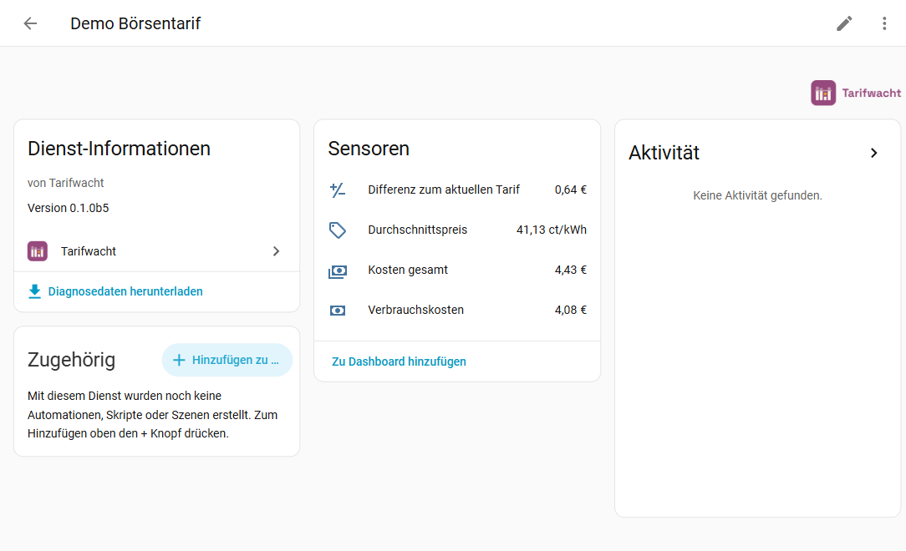
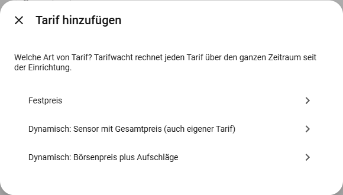
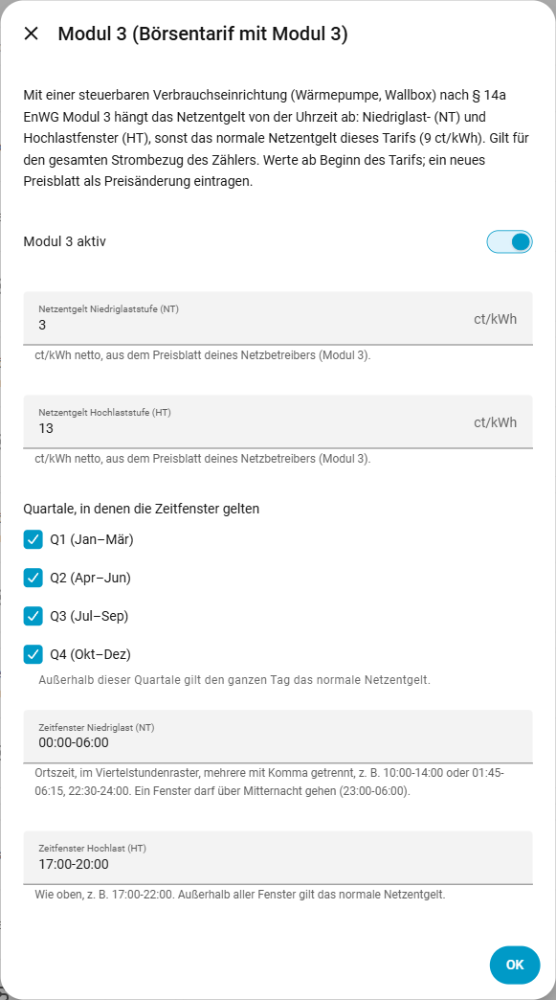
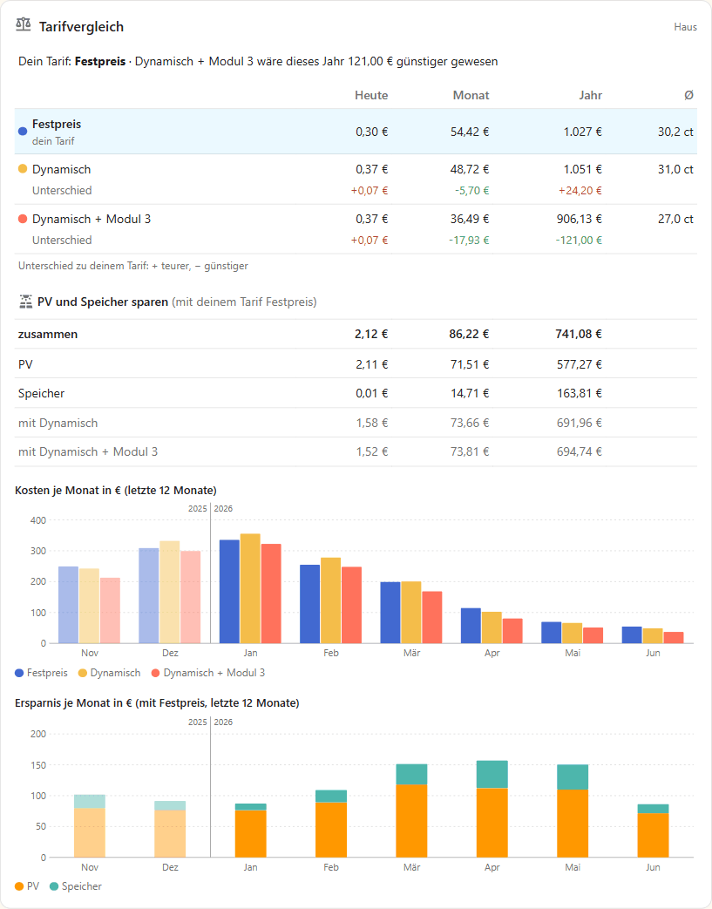
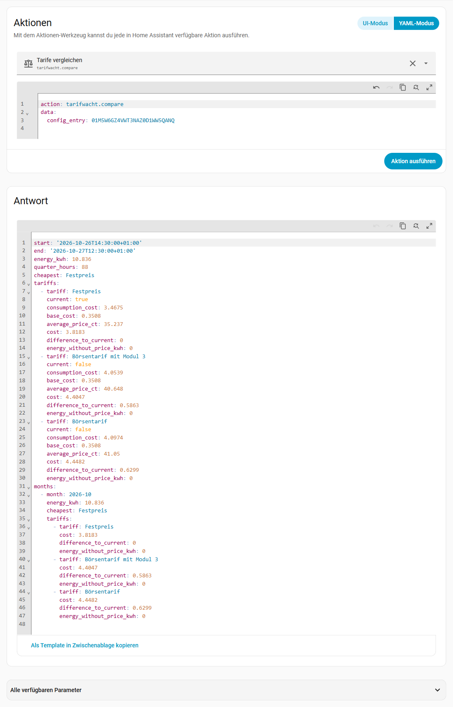

<picture>
  <source media="(prefers-color-scheme: dark)" srcset="https://raw.githubusercontent.com/tarifwacht/integration/main/assets/github/readme-header-dark@2x.png">
  
</picture>

[](https://hacs.xyz/)
[](https://github.com/tarifwacht/integration/releases)
[](https://github.com/tarifwacht/integration/actions/workflows/ci.yml)
[](LICENSE)
[](https://tarifwacht.github.io/integration/?lang=de)

🇩🇪 **Deutsch** · 🇬🇧 [English](https://github.com/tarifwacht/integration/blob/main/README.en.md)

**Was hätte dein Strom mit einem anderen Tarif gekostet?** Tarifwacht rechnet deinen tatsächlichen Strombezug in Home Assistant Viertelstunde für Viertelstunde gegen beliebig viele Tarife – Festpreis, dynamisch, mit oder ohne Modul 3 – und zeigt, welcher günstiger gewesen wäre. Jeder dynamische Tarif bekommt dabei den Preis **genau dieser Viertelstunde**, nicht den Preis des Augenblicks, in dem der Zähler zufällig meldet.

**Ausprobieren ohne Installation:** Die [Demo](https://tarifwacht.github.io/integration/?lang=de) zeigt die Karte, Dashboard, Geräte, Monatsübersicht und Jahresrückblick für eine Wohnung und ein Haus mit PV, Speicher, E-Auto und Wärmepumpe, dort auch die Ersparnis durch PV und Speicher – mit erfundenen Preisen und Tarifen, aber gerechnet vom Code der Integration.

> **Keine Abrechnungs- oder Tarifberatung.** Die Werte sind eine Orientierung. Maßgeblich ist die Abrechnung deines Stromanbieters.

Die Oberfläche gibt es auf Deutsch und Englisch; sie folgt der Sprache deines Home Assistant.



## Inhalt

- [Was Tarifwacht kann](#was-tarifwacht-kann) · [Hinweise zum Vergleich](#hinweise-zum-vergleich) · [Was Tarifwacht nicht kann](#was-tarifwacht-nicht-kann)
- **Loslegen:** [Voraussetzungen](#voraussetzungen) · [Installation](#installation) · [Einrichtung](#einrichtung) · [Weitere Tarife](#weitere-tarife) · [Dynamischen Tarif anlegen](#dynamischen-tarif-anlegen) · [Tarif ändern](#tarif-ändern) · [Modul 3](#modul-3--14a-enwg) · [PV und Speicher](#pv-und-speicher)
- **Nutzen:** [Entitäten](#entitäten) · [Karte](#karte) · [Dashboard](#dashboard-tarifvergleich) · [Vergleich für einen Zeitraum](#vergleich-für-einen-zeitraum) · [Rückblick vor der Einrichtung](#rückblick-vor-der-einrichtung) · [Statistik nachtragen](#statistik-nachtragen) · [Statistik neu berechnen](#statistik-neu-berechnen)
- **Mehr:** [Datenschutz](#datenschutz) · [Fehlerbehebung](#fehlerbehebung) · [Entfernen](#entfernen) · [Fehler melden](#fehler-melden) · [Danke](#danke) · [Weitere Wachten](#weitere-wachten)

## Was Tarifwacht kann

- **Kosten je Tarif** (€): Verbrauchskosten und Kosten gesamt (mit Grundpreis) – mit Langzeitstatistik für Statistik-Karten und Energie-Dashboard.
- **Differenz zum aktuellen Tarif** (€) für jeden anderen Tarif. Positiv heißt: Dieser Tarif wäre teurer gewesen; negativ: günstiger.
- **Durchschnittspreis** je Tarif (ct/kWh, mit Grundpreis) und **Günstigster Tarif** bisher.
- **Beliebig viele Tarife:** Festpreis, dynamisch mit einem Gesamtpreis-Sensor oder dynamisch aus Börsenpreis plus Netzentgelt, Steuern/Abgaben, Anbieteraufschlag und Mehrwertsteuer.
- **Modul 3** (§ 14a EnWG): zeitvariables Netzentgelt mit Niedrig- und Hochlastfenstern je Quartal.
- **Ersparnis durch PV und Speicher** je Tarif (€): was PV-Anlage und Speicher gegenüber dem Bezug des ganzen Verbrauchs gespart haben, mit Einspeisevergütung und § 51 EEG – Hybrid-Wechselrichter und eigene Speicher-Wechselrichter, siehe [PV und Speicher](#pv-und-speicher).
- **Eigene Karte fürs Dashboard:** dein Tarif, ob ein anderer günstiger gewesen wäre und was PV und Speicher sparen – heute, im Monat und im Jahr, dazu Säulen je Monat. Ohne Zusatzkarten aus HACS, siehe [Karte](#karte).
- **Preisänderungen ab einem Datum**, z. B. neue Netzentgelte zum 1. Januar – davor gelten die alten Preise weiter.
- **Grundpreise** optional, pro Monat oder pro Jahr, tageweise anteilig.
- **Vergleich für einen beliebigen Zeitraum** per Aktion, je Monat aufgeschlüsselt – auch **vor der Einrichtung**, so weit die Langzeitstatistik deines Zählers zurückreicht: Was hätte dich das letzte Jahr mit jedem Tarif gekostet? Auf Wunsch auch [in die Langzeitstatistik nachgetragen](#statistik-nachtragen).
- **Rechnet jeden Tarif ab der Einrichtung:** Verbrauch und Preise werden je Viertelstunde gespeichert. Ein später hinzugefügter oder korrigierter Tarif gilt deshalb für den ganzen Zeitraum; kennt der Preissensor eines neuen Tarifs die Zeit davor nicht, holt Tarifwacht die Preise aus dem Recorder bzw. – nur mit deinem Haken im Tarif – von SMARD.de.
- **Verliert nichts:** Fällt der Zähler aus oder startet Home Assistant neu, wird der Verbrauch der Lücke nachgebucht. Fehlt ein Preis, rechnet Tarifwacht nie mit 0 €. Zähler-Resets und unplausible Sprünge werden erkannt und nicht gebucht.
- **Schont SD-Karten:** schreibt nur einmal pro Viertelstunde (abgeschlossene Tage einmal am Tag ins Jahresarchiv) und aktualisiert die Sensoren höchstens einmal pro Minute.
- Rein lokal: liest nur vorhandene Entitäten, keine Cloud. Öffentliche Börsenpreise von SMARD.de lädt Tarifwacht nur, wenn du es ausdrücklich auslöst: mit den Aktionen (Rückblick, Statistik nachtragen) oder mit dem Haken beim Hinzufügen bzw. Ändern eines Börsenpreis-Tarifs.

## Hinweise zum Vergleich

- Der Vergleich unterstellt das **gleiche Verbrauchsverhalten**. Mit einem dynamischen Tarif verschieben viele ihren Verbrauch in günstige Stunden – das kann der Vergleich nicht abbilden. Er zeigt also eher, was ein dynamischer Tarif *mindestens* bringt.
- Erfasse **alle Preisbestandteile auf beiden Seiten** gleich, sonst ist der Vergleich verzerrt. Der Gesamtpreis eines dynamischen Tarifs ist Börsenpreis plus Netzentgelt, Konzessionsabgabe, Umlagen, Stromsteuer und Anbieteraufschlag, dazu Mehrwertsteuer. Die Werte stehen in den Preisblättern von Anbieter und Netzbetreiber.
- Home Assistant misst meist mit einem eigenen Zähler (Lesekopf, Energiemessgerät), der Anbieter mit dem Zähler des Netzbetreibers. Kleine Abweichungen sind normal.

## Voraussetzungen

- Home Assistant 2026.3 oder neuer.
- Ein **Bezugszähler**: fortlaufender Energiesensor (Wh, kWh oder MWh) für den Strom aus dem Netz, am besten der Zähler am Netzanschlusspunkt.
- Für dynamische Tarife ein **Preissensor** in €/kWh, am besten mit Prognose je Viertelstunde oder Stunde:

| Quelle (Integration) | Gesamtpreis | Börsenpreis | Status |
|---|---|---|---|
| [EPEX Spot](https://github.com/mampfes/ha_epex_spot) | `…_total_price` | `…_market_price` | erprobt |
| [Nord Pool](https://github.com/custom-components/nordpool) (HACS) | Sensor mit MwSt. und Zusatzkosten | Sensor ohne MwSt. und Zusatzkosten | experimentell |
| [ENTSO-E](https://github.com/JaccoR/hass-entso-e) (HACS) | Durchschnittspreis-Sensor mit Aufschlägen | Durchschnittspreis-Sensor ohne Aufschläge | experimentell |

„Experimentell“ heißt: Das Format ist aus dem Quellcode der Integration und echten Marktdaten nachgebildet, aber noch nicht an einer laufenden Installation geprüft. Wenn du eine davon nutzt, freue ich mich über eine Rückmeldung mit der Diagnose-Datei. Die Nord-Pool-Integration von Home Assistant selbst liefert keine Prognose als Attribut und wird nicht unterstützt.

Ein Sensor ohne Prognose geht auch: Dann gilt sein aktueller Wert, bis er sich ändert. Läuft Home Assistant eine Zeit lang nicht, fehlen für diese Zeit aber die Preise – mit Prognose holt Tarifwacht sie nach.

## Installation

**Mit einem Klick:** [](https://my.home-assistant.io/redirect/hacs_repository/?owner=tarifwacht&repository=integration&category=integration) → installieren, Home Assistant neu starten → [](https://my.home-assistant.io/redirect/config_flow_start/?domain=tarifwacht)

Oder von Hand:

1. *Einstellungen → Marketplace → Durchstöbern*, nach Tarifwacht suchen und installieren (vor Home Assistant 2026.11: in HACS suchen und herunterladen). Home Assistant neu starten.
2. *Einstellungen → Geräte & Dienste → Integration hinzufügen → Tarifwacht*.

Hinweis: Im alten HACS-Dashboard (vor Home Assistant 2026.11) fehlt das Icon ([HACS-Issue #5171](https://github.com/hacs/integration/issues/5171)); im Marketplace und in den Einstellungen wird es angezeigt.

## Einrichtung

1. **Bezugszähler:** Name (z. B. „Haus“) und Zähler.
2. **Festpreistarif:** Arbeitspreis (ct/kWh, brutto), optional der Grundpreis pro Monat. Er wird „Mein aktueller Tarif“.
3. **Dynamischer Tarif:** erst die Art wählen – **Börsenpreis plus Aufschläge** (empfohlen, siehe [Dynamischen Tarif anlegen](#dynamischen-tarif-anlegen)) oder Sensor mit Gesamtpreis (auch eigener Tarif; rechnet nur ab der Einrichtung) –, dann die Preise.

Daraus entstehen die ersten beiden Tarife. Hast du Tarifwacht vor 0.1.0 mit einem Gesamtpreis-Sensor eingerichtet: den dynamischen Tarif zusätzlich als „Börsenpreis plus Aufschläge“ anlegen, danach kannst du den alten löschen.

### Weitere Tarife

*Tarifwacht → Tarif hinzufügen* und die Art wählen:



| Art | Eingaben |
|---|---|
| Festpreis | Arbeitspreis (ct/kWh, brutto) |
| Dynamisch: Sensor mit Gesamtpreis (auch eigener Tarif) | Jeder Sensor in €/kWh, der schon den ganzen Preis enthält: der Gesamtpreis eines dynamischen Tarifs oder auch dein eigener Tarif als Template-Sensor (etwa ein Tarif mit Tag- und Nachtpreis). Ein Sensor kennt nur seine eigene Vergangenheit – rechnet nur ab der Einrichtung |
| Dynamisch: Börsenpreis plus Aufschläge | Börsenpreis-Sensor; Netzentgelt, Steuern/Abgaben, Anbieteraufschlag (je ct/kWh netto); Mehrwertsteuer (%) |

Jeder Tarif hat einen optionalen Grundpreis (pro Monat oder pro Jahr) und den Schalter **Mein aktueller Tarif** – die anderen Tarife zeigen ihre Differenz zu diesem.

### Dynamischen Tarif anlegen

Nimm **Börsenpreis plus Aufschläge**. Nur damit kann Tarifwacht auch die Zeit vor der Einrichtung rechnen ([Rückblick](#rückblick-vor-der-einrichtung), [Statistik nachtragen](#statistik-nachtragen)) – die Börsenpreise von damals kommen von SMARD.de. Ein Sensor mit Gesamtpreis kennt nur die Zeit seit der Einrichtung – und fügst du ihn später hinzu, nur so weit, wie der Recorder seinen Verlauf aufbewahrt (meist 10 Tage).

Hast du in **EPEX Spot** einen Aufschlag und eine Steuer eingestellt, übernimm einfach diese Werte – dann rechnet der Tarif genau wie der Gesamtpreis von EPEX Spot:

| In EPEX Spot | In Tarifwacht |
|---|---|
| Sensor mit dem Marktpreis (Market Price) | Sensor mit Börsenpreis |
| Aufschlag absolut, z. B. 0,15 €/kWh | Anbieteraufschlag **15** ct/kWh (Tarifwacht rechnet in Cent: € × 100) |
| Steuer, z. B. 19 % | Mehrwertsteuer 19 % |

Netzentgelt sowie Steuern und Abgaben bleiben leer – sie stecken schon im Aufschlag. Geprüft für einen absoluten Aufschlag; einen prozentualen haben wir noch nicht nachgerechnet. Hast du die Preisblätter, kannst du den Aufschlag später aufteilen (*Tarif bearbeiten*).

### Tarif ändern

Beim Tarif auf das Zahnrad (*Konfigurieren*):

- **Tarif bearbeiten:** Name, aktueller Tarif und Preise **ab Beginn** – für Tippfehler und Korrekturen. Tarifwacht rechnet den ganzen Zeitraum neu.
- **Preisänderung ab einem Datum hinzufügen:** neue Preise ab Mitternacht dieses Tages (deutsche Ortszeit), z. B. eine Preiserhöhung des Anbieters oder neue Netzentgelte. Davor bleiben die bisherigen Preise. Das Formular ist mit den heute gültigen Preisen vorausgefüllt.
- **Preisänderung entfernen:** danach gelten wieder die Preise davor.
- **Modul 3** (bei „Börsenpreis plus Aufschläge“ und beim Festpreis), siehe unten.

Jede Änderung gilt rückwirkend für den ganzen Zeitraum; die Sensoren zeigen sofort die neuen Summen. Die Langzeitstatistik vergangener Stunden (Statistik-Diagramme, Monate der [Karte](#karte)) behält aber die alten Werte – dafür gibt es [Statistik neu berechnen](#statistik-neu-berechnen). Ein Reparaturhinweis erinnert daran.

Mehrere Zähler: je einen Eintrag anlegen. Name oder Zähler ändern: *Tarifwacht → ⋮ → Neu konfigurieren*.

**Zähler oder Preissensor umbenannt** (Entity-ID geändert, auch über „Entity-IDs neu erstellen“ am Gerät): Tarifwacht zieht die neue ID seit 0.1.2 selbst nach und lädt den Eintrag kurz danach neu; *Neu konfigurieren* ist nicht nötig. Die gespeicherten Preise und der letzte Zählerstand gehen mit, der Vergleich reicht also weiter bis zur Einrichtung zurück.

### Modul 3 (§ 14a EnWG)

Mit einer steuerbaren Verbrauchseinrichtung (Wärmepumpe, Wallbox) kannst du beim Netzbetreiber Modul 3 wählen: ein Netzentgelt, das von der Uhrzeit abhängt. Ob sich das lohnt, zeigt ein zweiter Tarif mit denselben Preisen und eingeschaltetem Modul 3.



- **Stufen:** Niedriglast (NT) und Hochlast (HT) in ct/kWh netto; außerhalb der Fenster gilt das normale Netzentgelt des Tarifs (Standardstufe).
- **Quartale:** in welchen Quartalen die Fenster gelten; in den anderen gilt den ganzen Tag die Standardstufe.
- **Zeitfenster:** Ortszeit im Viertelstundenraster, mehrere mit Komma getrennt, auch über Mitternacht – z. B. `23:00-06:00` oder `01:45-06:15, 22:30-24:00`.
- Alle Werte stehen im Preisblatt deines Netzbetreibers. Ändern sie sich (meist zum Jahreswechsel), das neue Preisblatt als Preisänderung ab dem Stichtag eintragen.
- Modul 3 gilt für den **gesamten** Netzbezug der Marktlokation, nicht nur für Wärmepumpe oder Wallbox. Das passt, solange das Gerät nicht über einen eigenen Zähler läuft.
- **Beim Festpreis:** Auch ein Anbieter mit festem Arbeitspreis kann Modul 3 weitergeben – der Energiepreis bleibt fest, nur der Netzentgelt-Anteil ändert sich. Dafür fragt das Formular zusätzlich das **im Festpreis enthaltene Netzentgelt** (die normale Stufe aus dem Preisblatt, ct/kWh netto) und die Mehrwertsteuer (Vorschlag 19 %). In den Fenstern der gewählten Quartale gilt dann Festpreis + (Netzentgelt des Fensters − enthaltenes Netzentgelt) × (1 + MwSt.), sonst der Festpreis. Beispiel: Festpreis 30 ct, enthalten 7,91 ct, NT 3,16 ct → in einem NT-Fenster im Januar 30 + (3,16 − 7,91) × 1,19 = 24,35 ct; im Mai 30 ct. Ein neues Preisblatt (z. B. ab 1. Januar) trägst du wie beim Börsenpreis-Tarif als Preisänderung ein, mit Festpreis und Modul-3-Werten.

Grundlage: Festlegung der Bundesnetzagentur BK8-22/010-A; Einzelheiten und Quellen in [docs/ENTWICKLUNG.md](docs/ENTWICKLUNG.md).

### PV und Speicher

Mit PV-Anlage (und Speicher) zeigt Tarifwacht in jedem Tarif, **was PV und Speicher gespart haben**: verglichen mit dem Fall, dass der ganze Verbrauch aus dem Netz käme. *Tarifwacht → Hinzufügen → PV und Speicher*:

- **Einspeisezähler** und **PV-Zähler** (kWh-Zähler mit Langzeitstatistik); optional **Speicher geladen** und **Speicher entladen**.
- **Einspeisevergütung** in ct/kWh und **Keine Vergütung bei negativen Preisen** (§ 51 EEG, für Anlagen ab 25.02.2025 mit Smart Meter). Dafür braucht es einen Börsenpreis: den Sensor des Börsenpreis-Tarifs oder einen eigenen (z. B. EPEX Spot Marktpreis).
- Hast du [Einspeisewacht](https://github.com/einspeisewacht/integration) oder [Speicherwacht](https://github.com/speicherwacht/integration) eingerichtet, schlägt Tarifwacht die Zähler von dort vor: aus Einspeisewacht Einspeisezähler, Vergütung, § 51 und Börsenpreis, aus Speicherwacht die beiden Speicherzähler (einmalig übernommen, keine Abhängigkeit; das Formular nennt den Eintrag, bei mehreren den ersten).
- **Speicher am selben Wechselrichter wie die PV?** Ja bei einem Hybrid-Wechselrichter (z. B. Fronius Gen24, Huawei, Kostal Plenticore) – dann ist der PV-Zähler dessen AC-Erzeugung, Speicher inklusive. Nein bei einem Speicher mit eigenem Wechselrichter (z. B. SMA Sunny Boy Storage, Anker SOLIX, Zendure). Die Einrichtung schlägt die Antwort aus deinen Daten vor: Zählt der PV-Zähler nachts, während der Speicher entlädt, hängt er am selben Wechselrichter.

Gerechnet wird je Stunde und Tarif in drei Fällen: **ohne PV und Speicher** (Verbrauch × Preis), **nur PV** (gedacht ohne Speicher: was über die PV hinaus gebraucht wird, kommt aus dem Netz, der Rest wird eingespeist) und **tatsächlich** (Bezug × Preis minus Einspeiseerlös). *Ersparnis PV* ist der Unterschied der ersten beiden, *Ersparnis Speicher* der der letzten beiden. Grundpreise sind in allen Fällen gleich und bleiben außen vor. Der Verbrauch ergibt sich aus den Zählern (Bezug − Einspeisung + PV, beim eigenen Speicher-Wechselrichter zusätzlich + entladen − geladen). Für Speicher hinter einem Hybrid-Wechselrichter rechnet Tarifwacht mit 95 % Wirkungsgrad des Wechselrichters (90 bis 97 % ändern ein Jahr nur um wenige Euro).

- **Stündlich aus der Langzeitstatistik**, seit der Einrichtung des Tarifwacht-Eintrags; die Aktion [Tarife vergleichen](#vergleich-für-einen-zeitraum) rechnet auch davor.
- Innerhalb einer Stunde werden PV und Verbrauch verrechnet: Die Ersparnis der PV fällt dadurch etwas zu hoch aus, die des Speichers etwas zu niedrig (gerade diese Lücken füllt der Speicher).
- Mit dynamischem Tarif spart die PV meist etwas weniger als mit Festpreis, weil der Strom mittags dort billig ist. Der Speicher kann dagegen mehr wert sein, wenn er abends teuren Strom ersetzt – das hängt vom Festpreis und vom Abend ab, den er abdeckt.

## Entitäten

Am Gerät des Zählers (z. B. „Haus“):

| Entität | Einheit | Bedeutung |
|---|---|---|
| Strombezug | kWh | erfasste Menge seit der Einrichtung – zum Abgleich mit deinem Zähler |
| Günstigster Tarif | Text | Tarif mit den niedrigsten Kosten gesamt; Attribut `ranking` mit allen Tarifen (fehlende Preise siehe unten), Attribut `current` mit dem Namen deines aktuellen Tarifs |
| Bericht für Fehlermeldung | Schaltfläche (unter *Diagnose*) | zeigt einen kurzen Bericht zum Kopieren in ein Issue, siehe [Fehler melden](#fehler-melden) |

An jedem Tarif (z. B. „Haus Festpreis“):

| Entität | Einheit | Bedeutung |
|---|---|---|
| Verbrauchskosten | € | Strombezug × Preis der jeweiligen Viertelstunde |
| Kosten gesamt | € | Verbrauchskosten plus Grundpreis |
| Durchschnittspreis | ct/kWh | Kosten gesamt ÷ Strombezug |
| Differenz zum aktuellen Tarif | € | Kosten gesamt minus Kosten des aktuellen Tarifs (fehlt beim aktuellen Tarif selbst; fehlende Preise siehe unten) |
| Ersparnis PV | € | nur mit [PV und Speicher](#pv-und-speicher): was die PV seit der Einrichtung gespart hat; Attribute `since` (Beginn), `cost_without_pv_and_battery`, `cost_pv_without_battery`, `cost_actual`, Energiemengen (`consumption_kwh`, `pv_kwh`, `purchase_kwh`, `feed_in_kwh`, `feed_in_unpaid_kwh`), `hours`, `hours_left_out` |
| Ersparnis Speicher | € | nur mit Speicherzählern: was der Speicher zusätzlich gespart hat; Attribute `charged_kwh`, `discharged_kwh`, `value_per_kwh_ct` (Ersparnis je entladener kWh) |

Bei dynamischen Tarifen wartet der Verbrauch einer Viertelstunde bis zu 24 Stunden auf seinen Preis; meist ist er schon seit dem Vortag bekannt.

## Karte

Tarifwacht bringt eine eigene Karte mit, ganz ohne Zusatzkarten aus HACS. Sie zeigt auf einen Blick, **was dein Tarif kostet, ob ein anderer günstiger gewesen wäre und was PV und Speicher sparen** – heute, im Monat und im Kalenderjahr. Ausprobieren: [Demo](https://tarifwacht.github.io/integration/?lang=de).



*Dashboard bearbeiten → Karte hinzufügen* und nach „Tarifwacht“ suchen. Die Dashboard-Ressource trägt Tarifwacht selbst ein (*Einstellungen → Dashboards → ⋮ → Ressourcen*, beim Entfernen des letzten Eintrags wieder ausgetragen; bei Ressourcen im YAML-Modus lädt Home Assistant die Karte stattdessen direkt). Im Editor wählst du nur den Eintrag (seinen Sensor „Günstigster Tarif“); Tarife, deren Sensoren und PV und Speicher findet die Karte selbst, auch nach dem Umbenennen von Entitäten.

- **Kopfzeile:** dein Tarif (der als aktuell markierte) und ob er dieses Jahr am günstigsten war – sonst, welcher Tarif wie viel günstiger gewesen wäre. Gezählt wird das Kalenderjahr bis jetzt, wie in der Spalte „Jahr“ (der Betrag ist dort der Unterschied dieses Tarifs); im Jahr der Einrichtung ab der Einrichtung, mit [Statistik nachtragen](#statistik-nachtragen) ab dem 1. Januar. Der Sensor „Günstigster Tarif“ zählt dagegen seit der Einrichtung.
- **Tarife:** Kosten gesamt (mit Grundpreis) je Tarif heute, im Monat und im Jahr, dazu der Durchschnittspreis seit der Einrichtung (Ø). Dein Tarif steht oben und ist hervorgehoben; unter jedem anderen Tarif der **Unterschied** zu deinem, rot wenn er teurer gewesen wäre, grün wenn günstiger.
- **PV und Speicher** (nur mit [PV und Speicher](#pv-und-speicher)): was PV und Speicher mit deinem Tarif gespart haben, zusammen und einzeln (die Zeile Speicher nur mit Speicherzählern), und darunter, was sie zusammen mit jedem anderen Tarif gespart hätten.
- **Diagramm:** Säulen der letzten zwölf Monate (der laufende und die elf davor) – Kosten je Tarif und die Ersparnis durch PV und Speicher mit deinem Tarif. Monate des Vorjahres sind blasser, eine dünne Linie vor dem Januar trennt die Jahre; kräftig ist also genau das Kalenderjahr, das die Spalte „Jahr“ zählt.

Die Werte je Zeitraum kommen aus der Langzeitstatistik, genau wie bei einer Statistik-Karte mit Kalenderzeitraum: Tag, Monat und Jahr in der Zeitzone von Home Assistant. Gibt es für einen Zeitraum keine Statistik, steht „–“. Mit [Statistik nachtragen](#statistik-nachtragen) reichen Monat, Jahr und Diagramm auch vor die Einrichtung zurück. Die Karte fragt die Statistik nach jedem Fünf-Minuten-Lauf des Recorders neu ab, mehrere Karten teilen sich die Abfragen, und solange die Seite im Hintergrund ist, fragt sie nichts. Ein Klick auf einen Wert öffnet die Details.

```yaml
type: custom:tarifwacht-card
entity: sensor.haus_gunstigster_tarif  # Sensor „Günstigster Tarif“ des Eintrags
# parts: [tariffs, solar, chart]       # Teile; ohne: alle, die der Eintrag hat
# periods: [day, month, year]          # Zeiträume; ohne: alle drei
# title: Strom                         # eigene Überschrift; ein Leerzeichen blendet sie aus
```

| Option | Bedeutung |
| --- | --- |
| `entity` | Der Sensor „Günstigster Tarif“ des Eintrags (jeder andere Sensor des Eintrags geht auch). Ohne: der erste Tarifwacht-Eintrag. |
| `parts` | `tariffs` (Kopfzeile und Tarife), `solar` (PV und Speicher), `chart` (Säulen je Monat). Ohne: alle; PV und Speicher nur, wenn der Eintrag sie hat. |
| `periods` | `day` (heute), `month`, `year` (Kalenderjahr). Ohne: alle drei. |
| `title` | Eigene Überschrift; ein einzelnes Leerzeichen blendet sie aus. |

Die Karte darf mehrfach ins Dashboard, etwa einmal mit `parts: [tariffs, chart]` beim Strom und einmal mit `parts: [solar]` neben dem Speicher. Mit nur `chart` zeigt sie beide Diagramme.

**Die Karte taucht in der Suche nicht auf oder dreht nur?** Home Assistant lädt sie mit der Integration, also erst nach dem Neustart und mit einem eingerichteten Tarifwacht-Eintrag. Ins Dashboard kommt sie beim Laden der Seite: danach einmal neu laden (Strg+F5), in der Companion-App den Frontend-Cache zurücksetzen. Ob die Datei da ist, zeigt `http://<HA-Adresse>:8123/tarifwacht/tarifwacht-card.js`.

## Dashboard: Tarifvergleich

Wer lieber mit den Standardkarten von Home Assistant baut (statt der [Karte](#karte)): Tages-, Monats- und Jahreswerte liefert die Langzeitstatistik – eigene Zähler braucht es nicht. Ein fertiger Abschnitt für eine Sektionen-Ansicht: dein Tarif und der günstigste, Durchschnittspreise, Kosten je Tarif heute, im Monat und im Jahr, die Differenz und ein Balkendiagramm je Tag. *Dashboard bearbeiten → Abschnitt hinzufügen → ⋮ → Im Code-Editor bearbeiten*; die Entitäts-IDs hängen von deinen Namen ab (hier Zähler „Haus“, Tarife „Festpreis“ (dein aktueller) und „Dynamisch“):

```yaml
type: grid
column_span: 2
cards:
  - type: heading
    heading: Tarifvergleich
    icon: mdi:scale-balance
  - type: tile
    entity: sensor.haus_gunstigster_tarif
    name: Dein Tarif
    state_content: current
    grid_options: {columns: 6}
  - type: tile
    entity: sensor.haus_gunstigster_tarif
    name: Bisher am günstigsten
    grid_options: {columns: 6}
  - type: tile
    entity: sensor.haus_festpreis_durchschnittspreis
    name: Ø Festpreis
    grid_options: {columns: 6}
  - type: tile
    entity: sensor.haus_dynamisch_durchschnittspreis
    name: Ø Dynamisch
    grid_options: {columns: 6}
  - type: heading
    heading_style: subtitle
    heading: Festpreis (dein Tarif)
  - type: statistic
    entity: sensor.haus_festpreis_kosten_gesamt
    name: Heute
    stat_type: change
    period: {calendar: {period: day}}
    grid_options: {columns: 4}
  - type: statistic
    entity: sensor.haus_festpreis_kosten_gesamt
    name: Monat
    stat_type: change
    period: {calendar: {period: month}}
    grid_options: {columns: 4}
  - type: statistic
    entity: sensor.haus_festpreis_kosten_gesamt
    name: Jahr
    stat_type: change
    period: {calendar: {period: year}}
    grid_options: {columns: 4}
  - type: heading
    heading_style: subtitle
    heading: Dynamisch
  - type: statistic
    entity: sensor.haus_dynamisch_kosten_gesamt
    name: Heute
    stat_type: change
    period: {calendar: {period: day}}
    grid_options: {columns: 4}
  - type: statistic
    entity: sensor.haus_dynamisch_kosten_gesamt
    name: Monat
    stat_type: change
    period: {calendar: {period: month}}
    grid_options: {columns: 4}
  - type: statistic
    entity: sensor.haus_dynamisch_kosten_gesamt
    name: Jahr
    stat_type: change
    period: {calendar: {period: year}}
    grid_options: {columns: 4}
  - type: heading
    heading_style: subtitle
    heading: "Differenz Dynamisch – positiv: wäre teurer gewesen"
  - type: statistic
    entity: sensor.haus_dynamisch_differenz_zum_aktuellen_tarif
    name: Heute
    stat_type: change
    period: {calendar: {period: day}}
    grid_options: {columns: 4}
  - type: statistic
    entity: sensor.haus_dynamisch_differenz_zum_aktuellen_tarif
    name: Monat
    stat_type: change
    period: {calendar: {period: month}}
    grid_options: {columns: 4}
  - type: statistic
    entity: sensor.haus_dynamisch_differenz_zum_aktuellen_tarif
    name: Jahr
    stat_type: change
    period: {calendar: {period: year}}
    grid_options: {columns: 4}
  - type: statistics-graph
    title: Kosten je Tag
    chart_type: bar
    period: day
    days_to_show: 30
    stat_types: [change]
    entities:
      - entity: sensor.haus_festpreis_kosten_gesamt
        name: Festpreis
      - entity: sensor.haus_dynamisch_kosten_gesamt
        name: Dynamisch
    grid_options: {columns: full}
```

„Jahr“ ist das Kalenderjahr. „Dein Tarif“ zeigt das Attribut `current` von „Günstigster Tarif“, folgt also dem Tarif, den du als aktuell markierst. Für einen Jahresüberblick im Diagramm `period: month` und `days_to_show: 365`. Mit [Statistik nachtragen](#statistik-nachtragen) zeigen die Karten auch die Zeit vor der Einrichtung.

**PV und Speicher** mit Standardkarten: was beide je Monat und Jahr gespart haben, mit deinem Tarif und mit dem dynamischen, dazu Säulen je Monat (Entitäten von [PV und Speicher](#pv-und-speicher); ohne Speicherzähler die Zeilen „Speicher“ weglassen). Eine Summe von PV und Speicher können die Standardkarten nicht bilden – die [Karte](#karte) zeigt sie.

```yaml
type: grid
column_span: 2
cards:
  - type: heading
    heading: PV und Speicher sparen
    icon: mdi:solar-power-variant
  - type: heading
    heading_style: subtitle
    heading: Mit Festpreis (dein Tarif)
  - type: statistic
    entity: sensor.haus_festpreis_ersparnis_pv
    name: PV Monat
    stat_type: change
    period: {calendar: {period: month}}
    grid_options: {columns: 6}
  - type: statistic
    entity: sensor.haus_festpreis_ersparnis_pv
    name: PV Jahr
    stat_type: change
    period: {calendar: {period: year}}
    grid_options: {columns: 6}
  - type: statistic
    entity: sensor.haus_festpreis_ersparnis_speicher
    name: Speicher Monat
    stat_type: change
    period: {calendar: {period: month}}
    grid_options: {columns: 6}
  - type: statistic
    entity: sensor.haus_festpreis_ersparnis_speicher
    name: Speicher Jahr
    stat_type: change
    period: {calendar: {period: year}}
    grid_options: {columns: 6}
  - type: heading
    heading_style: subtitle
    heading: Mit Dynamisch
  - type: statistic
    entity: sensor.haus_dynamisch_ersparnis_pv
    name: PV Monat
    stat_type: change
    period: {calendar: {period: month}}
    grid_options: {columns: 6}
  - type: statistic
    entity: sensor.haus_dynamisch_ersparnis_pv
    name: PV Jahr
    stat_type: change
    period: {calendar: {period: year}}
    grid_options: {columns: 6}
  - type: statistic
    entity: sensor.haus_dynamisch_ersparnis_speicher
    name: Speicher Monat
    stat_type: change
    period: {calendar: {period: month}}
    grid_options: {columns: 6}
  - type: statistic
    entity: sensor.haus_dynamisch_ersparnis_speicher
    name: Speicher Jahr
    stat_type: change
    period: {calendar: {period: year}}
    grid_options: {columns: 6}
  - type: statistics-graph
    title: Ersparnis je Monat (Festpreis)
    chart_type: bar
    period: month
    days_to_show: 365
    stat_types: [change]
    entities:
      - entity: sensor.haus_festpreis_ersparnis_pv
        name: PV
      - entity: sensor.haus_festpreis_ersparnis_speicher
        name: Speicher
    grid_options: {columns: full}
```

## Vergleich für einen Zeitraum

*Einstellungen → Werkzeuge → Aktionen* (früher *Entwicklerwerkzeuge → Aktionen*) → **Tarife vergleichen**, Zähler und Zeitraum wählen, „Antwort anzeigen“:

```yaml
action: tarifwacht.compare
data:
  config_entry: <Eintrag auswählen>
  start: "2026-11-01 00:00:00"
  end: "2026-12-01 00:00:00"
```



Die Antwort enthält Strombezug und Anzahl der Viertelstunden im Zeitraum, den günstigsten Tarif und je Tarif – günstigster zuerst – die Kosten gesamt, Verbrauchs- und Grundpreiskosten, den Durchschnittspreis und die Differenz zum aktuellen Tarif; unter `months` dasselbe kürzer je Kalendermonat. Mit [PV und Speicher](#pv-und-speicher) kommt `pv_battery` dazu: je Tarif Ersparnis PV und Speicher, die drei Fälle und die Energiemengen, auch je Monat (vor der Einrichtung mit Börsenpreisen von SMARD.de, falls § 51 gilt). Ohne Beginn bzw. Ende: seit der Einrichtung bzw. bis jetzt. Zeiten ohne Zeitzone gelten als Ortszeit deines Home Assistant.

### Rückblick vor der Einrichtung

Liegt der Beginn vor der Einrichtung, rechnet Tarifwacht diese Zeit nach:

- **Verbrauch:** aus der Langzeitstatistik deines Bezugszählers. Sie hat Stundenwerte; jede Stunde wird gleichmäßig auf ihre vier Viertelstunden verteilt. Für einen Festpreis ist das exakt, bei dynamischen Preisen eine gute Näherung (seit 1. Oktober 2025 wechselt der Börsenpreis jede Viertelstunde).
- **Börsenpreise:** von [SMARD.de](https://www.smard.de) (Bundesnetzagentur), Day-Ahead DE-LU – dieselben Preise wie der Marktpreis von EPEX Spot. Tarifwacht lädt sie beim ersten Vergleich einer Zeit (je Woche eine Anfrage, ein Jahr dauert etwa eine halbe Minute) und speichert sie; danach geht es ohne Abruf.
- **Welche Tarife:** Festpreis und „Börsenpreis plus Aufschläge“ (auch mit Modul 3 und Preisänderungen). Ein **Sensor mit Gesamtpreis** kennt nur die Zeit seit der Einrichtung – solche Tarife stehen dann mit `energy_without_price_kwh` am Ende, zählen nicht als günstigster und haben keine Differenz zum aktuellen Tarif (`null`), weil sie sonst günstiger aussähen, als sie sind. Tipp: den dynamischen Tarif als „Börsenpreis plus Aufschläge“ anlegen, siehe [Dynamischen Tarif anlegen](#dynamischen-tarif-anlegen).
- Unter `estimate` steht, bis wann geschätzt wurde, wie viel Energie das war und wie viele Stunden in der Statistik fehlen (z. B. weil es den Zähler noch nicht gab); dazu die Quellenangabe von SMARD.de, falls Börsenpreise von dort nötig waren.
- Preise und Grundpreise gelten so, wie der Tarif heute eingetragen ist (mit seinen Preisänderungen). Für einen Vergleich über einen Jahreswechsel die alten Preise als Preisänderung eintragen, z. B. die Netzentgelte des Vorjahres.

Die Antwort lässt sich auch in Skripten und Automationen verwenden (`response_variable`) – fertig als Blueprint:

| Blueprint | Was er tut | |
| --- | --- | --- |
| **Monatsübersicht** | schickt am Ersten jedes Monats Strombezug, Kosten jedes Tarifs, Differenz zum aktuellen Tarif und den günstigsten Tarif des Vormonats – als Benachrichtigung in Home Assistant oder mit einer eigenen Aktion (z. B. ans Handy) | [](https://my.home-assistant.io/redirect/blueprint_import/?blueprint_url=https%3A%2F%2Fgithub.com%2Ftarifwacht%2Fintegration%2Fblob%2Fmain%2Fblueprints%2Fautomation%2Ftarifwacht%2Fmonatsuebersicht.yaml) |

## Statistik nachtragen

Die Sensoren haben Langzeitstatistik erst ab der Einrichtung. Damit Statistik-Karten und Diagramme (z. B. der [Tarifvergleich](#dashboard-tarifvergleich)) auch die Zeit davor zeigen, gibt es die Aktion **Tarifwacht: Statistik nachtragen** (*Einstellungen → Werkzeuge → Aktionen*, früher *Entwicklerwerkzeuge → Aktionen*):

```yaml
action: tarifwacht.import_statistics
data:
  config_entry: <Zähler auswählen>
  start: "2026-01-01"
```

- Sie rechnet wie der [Rückblick](#rückblick-vor-der-einrichtung) und schreibt die Stunden **vor** dem ersten vorhandenen Statistikwert in die Langzeitstatistik von Strombezug, Verbrauchskosten, Kosten gesamt und Differenz; die späteren Summen werden passend verschoben. Ein später hinzugefügter Tarif bekommt so auch die Zeit seit der Einrichtung.
- Mit [PV und Speicher](#pv-und-speicher) auch **Ersparnis PV** und **Ersparnis Speicher**: alle Stunden vor ihrem ersten Statistikwert, also auch die Zeit zwischen Einrichtung und Hinzufügen von PV und Speicher. Danach zeigen Statistik-Karten mit Monat oder Jahr und das Diagramm „Ersparnis je Monat“ die ganze Zeit. Mit „keine Vergütung bei negativen Preisen“ kommen die Börsenpreise vor der Einrichtung von SMARD.de.
- Der Beginn muss vor der Einrichtung liegen; früher als die Langzeitstatistik deines Zählers geht es nicht (die Antwort nennt den tatsächlichen Beginn).
- Ein Tarif, dem im Zeitraum Preise fehlen – etwa ein **Sensor mit Gesamtpreis** –, wird ganz übersprungen und unter `skipped` genannt: lieber keine Vergangenheit als eine mit Lücken.
- **Unplausible Stunden** in der Statistik des Zählers (oder der PV- und Speicherzähler) bleiben außen vor und stehen unter `hours_implausible` (Anzahl und die ersten Stunden): eine Stunde mit mehr als **150 kWh** – dieselbe Grenze wie für jede Ablesung im laufenden Betrieb, 100 kW × 1,5; nach einer Pause von Home Assistant entsprechend mehr –, eine negative Stunde (Zähler getauscht) und die Stunde danach, in der der Zählerstand nach so einem Sprung wieder fällt. Typischer Fall: Ein Zähler meldet kurz Wh als kWh (107 → 109.851 → 110 kWh); ohne die Prüfung käme so ein Tag auf über 100.000 kWh. Eine volle Stunde mit Wallbox und Wärmepumpe (etwa 20 kWh) bleibt drin. Dasselbe gilt für den [Rückblick](#rückblick-vor-der-einrichtung) (`estimate.hours_implausible`, bei PV und Speicher `pv_battery.hours_implausible`) und die Sensoren „Ersparnis PV/Speicher“.
- **Das greift in die Statistik-Datenbank ein – vorher ein Backup anlegen.** Ein zweiter Aufruf findet nichts mehr nachzutragen.

### Statistik neu berechnen

Korrigierst du einen Tarif (Preise, Grundpreis, Preisänderung ab einem Datum, Modul 3, aktueller Tarif) oder PV und Speicher, rechnet Tarifwacht den ganzen Zeitraum neu – Sensoren und die Aktion „Tarife vergleichen“ stimmen sofort. Die Langzeitstatistik vergangener Stunden, aus der Statistik-Diagramme, Werte je Tag und Monat und die [Karte](#karte) kommen, behält dagegen die alten Werte, auch nachgetragene. Dafür gibt es am Gerät des Zählers die Schaltfläche **Statistik neu berechnen** (unter *Konfiguration*):

- Sie berechnet die Statistik aller Tarifwacht-Sensoren mit Summe (Strombezug, Verbrauchskosten, Kosten gesamt, Differenz, Ersparnis PV/Speicher) von deren erstem Statistikwert bis zur letzten vollen Stunde mit den heutigen Tarifen neu – vor der Einrichtung wie beim Nachtragen, danach aus den gespeicherten Viertelstunden. Die Statistik danach schließt ohne Sprung an; Home Assistant zählt von dort weiter.
- Das Ergebnis erscheint als Benachrichtigung: welcher Zeitraum, um wie viel sich die Summe jedes Sensors geändert hat, welche Tarife wegen fehlender Preise ausgelassen wurden und welche Stunden unplausibel waren. Der Reparaturhinweis nach der Tarifänderung verschwindet danach.
- Sensoren ohne Statistik bleiben, wie sie sind. Zweimal drücken ergibt dasselbe.
- Auch die Fünf-Minuten-Statistik der letzten 10 Tage wird neu berechnet; ältere (bei längerem `purge_keep_days`) bleibt, die sehen nur Fünf-Minuten-Diagramme.
- Dasselbe ab einem bestimmten Tag: die Aktion **Statistik nachtragen** mit **Vorhandene Statistik ersetzen** (`replace: true`). Davor bleibt die Statistik unverändert; liegt der Tag vor dem ersten Statistikwert, wird die Zeit davor wie beim Nachtragen ergänzt.
- **Auch das greift in die Statistik-Datenbank ein – vorher ein Backup anlegen.**

## Datenschutz

Tarifwacht rechnet lokal und liest nur die Entitäten, die du auswählst. Einzige Ausnahme, und nur auf deine ausdrückliche Aktion: Vergleichst du eine Zeit vor der Einrichtung, trägst du Statistik nach oder setzt du beim Hinzufügen bzw. Ändern eines Tarifs „Börsenpreis plus Aufschläge“ den Haken „Zeit seit der Einrichtung mit Börsenpreisen von SMARD.de nachtragen“, lädt Tarifwacht öffentliche Börsenpreise von SMARD.de. Ohne den Haken bleibt diese Zeit beim neuen Tarif außen vor (siehe `energy_left_out_kwh`). Dabei wird nichts über dich übertragen – nur der Abruf der Preisdateien mit der Kennung `Tarifwacht/<Version>`. Die Diagnose-Datei enthält deine Tarifeinstellungen (Preise, Sensoren), aber weder Namen noch Zählerstände, Energie- oder Kostensummen. Was genau darin steht und was der kürzere Bericht für Fehlermeldung enthält, steht unter [Fehler melden](#fehler-melden).

## Was Tarifwacht nicht kann

- **Keine Abrechnung:** Abweichungen zur Rechnung sind normal (anderer Zähler, Rundung, Abschläge).
- **Kein verändertes Verhalten:** Der Vergleich rechnet deinen tatsächlichen Verbrauch – was du mit einem dynamischen Tarif verschieben würdest, sieht er nicht.
- **Sensoren beginnen bei der Einrichtung:** Die Zeit davor gibt es über die Aktion „Tarife vergleichen“ und – für Statistik-Karten – über [Statistik nachtragen](#statistik-nachtragen).
- **Keine Netzeinspeisung:** Tarifwacht rechnet nur den Bezug. Für die Einspeisung gibt es das Schwesterprojekt [Einspeisewacht](https://github.com/einspeisewacht/integration).
- **Module 1 und 2** nach § 14a EnWG bildet Tarifwacht nicht eigens ab.

## Fehlerbehebung

Tarifwacht meldet Probleme unter *Einstellungen → Reparaturen*:

- **Preissensor mit nicht unterstützter Einheit:** Der Sensor liefert z. B. ct/kWh oder €/MWh. Tarifwacht braucht €/kWh und ignoriert seine Preise bis dahin.
- **Zähler mit nicht unterstützter Einheit:** Tarifwacht bucht nichts, bis der Zähler Wh, kWh oder MWh liefert.
- **Entität fehlt:** Den Zähler oder einen Preissensor gibt es seit mindestens zehn Minuten nicht mehr, z. B. weil er gelöscht oder durch ein neues Gerät ersetzt wurde. Ohne Zähler bucht Tarifwacht nichts. Zähler unter *Tarifwacht → ⋮ → Neu konfigurieren*, Preissensor im Tarif neu wählen. Eine umbenannte Entität zieht Tarifwacht selbst nach (seit 0.1.2).
- **Sensor von Tarifwacht als Quelle gewählt:** Zähler oder Preissensor ist ein Sensor von Tarifwacht selbst, etwa „Strombezug“ als Zähler. Tarifwacht liest ihn nicht, sonst läse der Eintrag seine eigenen Ergebnisse: Ohne Zähler bucht er keinen Verbrauch. Was schon gebucht ist, bleibt. Den echten Zähler unter *Tarifwacht → ⋮ → Neu konfigurieren* wählen, einen Preissensor im Tarif. Neue Einträge und Tarife lassen das gar nicht erst zu.
- **Preise fehlen:** Für eine vergangene Viertelstunde fehlt der Preis, vermutlich ist die Preis-Integration ausgefallen. Nach 24 Stunden wird der Verbrauch ohne Preis gezählt – nie als kostenlos. Damit der betroffene Tarif nicht günstiger aussieht, lassen „Differenz zum aktuellen Tarif“ und „Günstigster Tarif“ solche Viertelstunden für alle Tarife aus; wie viel Strom das war, steht im Attribut `energy_left_out_kwh`. Das gilt auch für einen später hinzugefügten Sensor mit Gesamtpreis, soweit sein Verlauf im Recorder nicht mehr bis zur Einrichtung zurückreicht, und für einen später hinzugefügten Börsenpreis-Tarif ohne den Haken für SMARD.de.

Weiteres:

- **Werte bleiben bei 0:** Liefert der Bezugszähler Werte? „Strombezug“ sollte mit deinem Zähler mitwachsen.
- **Dynamische Kosten hinken hinterher:** Eine Viertelstunde wird erst gebucht, wenn ihr Preis bekannt ist. Mit Prognose ist das sofort der Fall; sonst siehe „Preise fehlen“.
- **Bericht für Fehlermeldung:** Schaltfläche am Gerät des Zählers unter *Diagnose*, siehe [Fehler melden](#fehler-melden). **Diagnose:** *Tarifwacht → Eintrag → ⋮ → Diagnosedaten herunterladen*. **Debug-Protokoll:** *Tarifwacht → ⋮ → Debug-Protokoll aktivieren*.

**Update von 0.1.0b1:** Die beiden Tarife werden zu eigenen Tarif-Einträgen, der Verbrauch seit der Einrichtung wird einmalig aus dem Verlauf (Recorder) nachgelesen. Die Sensoren behalten ihre Entitäts-IDs; „Mehrkosten dynamisch“ heißt jetzt „Differenz zum aktuellen Tarif“.

## Entfernen

1. *Einstellungen → Geräte & Dienste → Tarifwacht* → bei jedem Eintrag ⋮ → *Löschen*. Die gespeicherten Viertelstunden dieses Eintrags werden mit gelöscht.
2. Optional: *Einstellungen → Marketplace → Installiert* → Tarifwacht → ⋮ → *Deinstallieren* (vor Home Assistant 2026.11: HACS → Tarifwacht → ⋮ → *Entfernen*), dann Home Assistant neu starten.

Die Langzeitstatistik der gelöschten Sensoren bleibt in Home Assistant erhalten, bis du sie unter *Einstellungen → Werkzeuge → Statistik* (früher *Entwicklerwerkzeuge*) entfernst.

## Fehler melden

Bitte als [Issue](https://github.com/tarifwacht/integration/issues), mit dem **Bericht für Fehlermeldung**: *Tarifwacht → Eintrag → Gerät des Zählers (z. B. „Haus“) → Diagnose → Bericht für Fehlermeldung* drücken. Der Bericht erscheint als Benachrichtigung (Glocke unten links) zum Kopieren. Er enthält die Versionen, Zähler und Preissensoren nach Rolle (Integration, Einheit, Zustandsklasse, Zustand – beim Zähler nur, ob er eine Zahl liefert), die Tarife nach Art und Nummer mit Preisen, Grundpreis, Modul-3-Zeitfenstern und Preisänderungen, den Stand der Buchung (Beginn, gebuchte Viertelstunden, Preise je Tarif, SMARD.de), wie die Karte ins Dashboard kommt, Sensoren ohne Wert und offene Reparaturhinweise. Entity-IDs, die Namen von Eintrag und Tarifen, Bereiche, Zählerstände sowie Energie- und Kostensummen stehen nicht darin. Lies ihn trotzdem vor dem Teilen und lösche, was du nicht zeigen willst. Sicherheitslücken bitte vertraulich, siehe [SECURITY.md](SECURITY.md).

### Was steht in der Diagnose-Datei?

Reicht der Bericht nicht, kommt im Issue die Bitte um die Diagnose-Datei (*⋮ → Diagnosedaten herunterladen*). Sie ist ausführlicher, und nicht alles darin kommt von Tarifwacht:

- **Von Home Assistant** (jede Integration hat diesen Kopf, Tarifwacht kann ihn nicht ändern): Version und Installationsart, Betriebssystem, Zeitzone und unter `custom_components` die Liste **aller** installierten benutzerdefinierten Integrationen mit Versionen. Diese Blöcke darfst du vor dem Hochladen löschen, sie werden nicht gebraucht. Unter `issues` stehen die IDs der Reparaturhinweise; sie enthalten die ID des Eintrags, beim Hinweis zur Einheit eines Preissensors auch dessen Entity-ID.
- **Von Tarifwacht** (unter `data`): die Entity-IDs von Zähler und Preissensoren, die Einstellungen jedes Tarifs (Art, Preise, Grundpreis, Modul 3, Preisänderungen, Haken für SMARD.de – ohne den Namen des Tarifs), Beginn und Umfang der Buchung (Zahl der Viertelstunden, erste und letzte), je Preissensor Format, Auflösung und den Aufbau seiner Attribute (nur Schlüssel und Typen, keine Werte), Zählerereignisse, die Zeit der letzten Ablesung und Fehlermeldungen. Der Name des Eintrags, Zählerstände sowie Energie- und Kostensummen fehlen.

Willst du die Datei nicht öffentlich teilen, ist das in Ordnung: Dann reichen meist der Bericht und gezielte Angaben, nach denen im Issue gefragt wird.

Pull Requests sind willkommen. Wie, steht in [CONTRIBUTING.md](CONTRIBUTING.md).

## Danke

Die Idee, den eigenen Verbrauch in Home Assistant direkt gegen beide Tarife zu rechnen, stammt aus [tariff_compare](https://github.com/fischit87/tariff_compare) von fischit87.

## Weitere Wachten

Vom selben Autor und nach demselben Muster gebaut: Einrichtung über die Oberfläche, deutsch und englisch, schonend für SD-Karten.

- **Energie**
  - [Einspeisewacht](https://github.com/einspeisewacht/integration) – was negative Strompreise bei der PV-Einspeisung kosten (§ 51 EEG) · [Demo](https://einspeisewacht.github.io/integration/?lang=de)
  - [Speicherwacht](https://github.com/speicherwacht/integration) – Wirkungsgrad, Zyklen und Kapazität des Batteriespeichers · [Demo](https://speicherwacht.github.io/integration/?lang=de)
  - [Wärmewacht](https://github.com/waermewacht/integration) – Arbeitszahlen und Gesundheits-Check der Wärmepumpe · [Demo](https://waermewacht.github.io/integration/?lang=de)
- **Alltag**
  - [Eilwacht](https://github.com/eilwacht/integration) – Tagesschau-Eilmeldungen und Regionalnachrichten als Auslöser für Automationen · [Demo](https://eilwacht.github.io/integration/?lang=de)
  - [Streckenwacht](https://github.com/streckenwacht/integration) – Baustellen, Sperrungen und Staus auf den eigenen Strecken · [Demo](https://streckenwacht.github.io/integration/?lang=de)

## Lizenz

MIT. Historische Börsenpreise (nur auf deine Aktion: Vergleiche vor der Einrichtung, Statistik nachtragen, Haken bei einem später hinzugefügten Börsenpreis-Tarif): Bundesnetzagentur | [SMARD.de](https://www.smard.de), [CC BY 4.0](https://creativecommons.org/licenses/by/4.0/). Die Bilder in diesem README zeigen einen Demo-Eintrag mit erfundenem Verbrauch und erfundenen Preisen.
